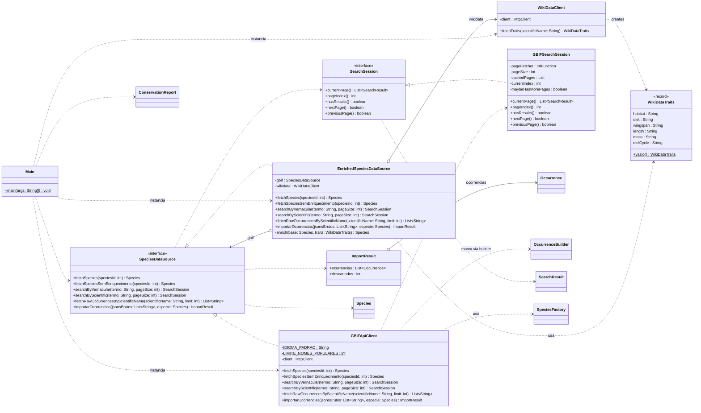

# Diagramas de Classes

## 1. Modelo de domínio (`model` e `factory`)

```mermaid
classDiagram
    direction TB

    class ConservationStatus {
        <<enumeration>>
        EXTINCT
        EXTINCT_IN_THE_WILD
        CRITICALLY_ENDANGERED
        ENDANGERED
        VULNERABLE
        NEAR_THREATENED
        LEAST_CONCERN
        DATA_DEFICIENT
        NOT_EVALUATED
        +normalizeAPI(rawString: String)$ ConservationStatus
        +emPortugues() String
    }

    class Species {
        <<abstract>>
        -id : int
        -scientificName : String
        -status : ConservationStatus
        -habitat : String
        -diet : String
        -length : String
        -mass : String
        +getId() int
        +getScientificName() String
        +getStatus() ConservationStatus
        +getHabitat() String
        +getDiet() String
        +getLength() String
        +getMass() String
        #appendCampo(sb: StringBuilder, rotulo: String, valor: String)$ void
        #describeCommonTraits() String
        +describeHabitat()* String
    }

    class Bird {
        +describeHabitat() String
    }
    class Plant {
        +describeHabitat() String
    }
    class Mammal {
        -behaviorPattern : String
        +describeHabitat() String
    }
    class Amphibian {
        +describeHabitat() String
    }
    class Reptile {
        +describeHabitat() String
    }
    class Insect {
        -wingType : String
        +describeHabitat() String
    }
    class Fish {
        +describeHabitat() String
    }
    class Mollusk {
        +describeHabitat() String
    }
    class Crustacean {
        +describeHabitat() String
    }
    class GenericSpecies {
        -taxonomicClass : String
        +getTaxonomicClass() String
        +describeHabitat() String
    }

    class Occurrence {
        -Occurrence(builder: OccurrenceBuilder)
        -date : Date
        -latitude : double
        -longitude : double
        -speciesRef : Species
        -horarioConhecido : boolean
        +setDate(d: Date) void
        +setCoordinates(lat: double, lon: double) void
        +setHorarioConhecido(horarioConhecido: boolean) void
        +getDate() Date
        +getLatitude() double
        +getLongitude() double
        +getSpeciesRef() Species
        +isHorarioConhecido() boolean
    }

    class OccurrenceBuilder {
        <<Occurrence.Builder>>
        +data(date: Date) OccurrenceBuilder
        +coordenadas(lat: double, lon: double) OccurrenceBuilder
        +especie(especie: Species) OccurrenceBuilder
        +horarioConhecido(conhecido: boolean) OccurrenceBuilder
        +build() Occurrence
    }

    class CriadorDeEspecie {
        <<abstract>>
        #criar(id: int, nome: String, status: ConservationStatus)* Species
        +criarDaAPI(id: int, nome: String, statusBruto: String) Species
    }

    class SearchResult {
        -key : int
        -scientificName : String
        -taxonomicClass : String
        -vernacularNames : List~String~
        +getKey() int
        +getScientificName() String
        +getTaxonomicClass() String
        +getVernacularNames() List~String~
    }

    class ConservationReport {
        -ConservationReport()
        +agruparPorStatus(especies: List~Species~)$ Map
        +formatar(especies: List~Species~)$ String
    }

    class SpeciesFactory {
        +createFromAPI(id: int, name: String, taxonomicClass: String, rawStatus: String)$ Species
    }

    Species <|-- Bird
    Species <|-- Plant
    Species <|-- Mammal
    Species <|-- Amphibian
    Species <|-- Reptile
    Species <|-- Insect
    Species <|-- Fish
    Species <|-- Mollusk
    Species <|-- Crustacean
    Species <|-- GenericSpecies

    Species --> ConservationStatus : status
    Occurrence --> Species : speciesRef

    OccurrenceBuilder ..> Occurrence : build
    Occurrence +-- OccurrenceBuilder : nested
    CriadorDeEspecie <|-- CriadorDeAve
    CriadorDeEspecie <|-- CriadorDeMamifero
    CriadorDeEspecie <|-- CriadorDeInseto
    CriadorDeEspecie <|-- CriadorDePlanta
    CriadorDeEspecie <|-- CriadorDeAnfibio
    CriadorDeEspecie <|-- CriadorDeReptil
    CriadorDeEspecie <|-- CriadorDePeixe
    CriadorDeEspecie <|-- CriadorDeMolusco
    CriadorDeEspecie <|-- CriadorDeCrustaceo
    CriadorDeEspecie <|-- CriadorDeEspecieGenerica
    CriadorDeEspecie ..> Species : factory method
    CriadorDeEspecie ..> ConservationStatus : normalizeAPI
    SpeciesFactory ..> CriadorDeEspecie : escolhe e delega
    ConservationReport ..> Species : agrupa
    ConservationReport ..> ConservationStatus : agrupa por
```

## 2. Camada de acesso a dados (`api`) e `Main`




---

# Padrões Criacionais aplicados

Atividade: identificar onde padrões criacionais devem ser aplicados e aplicá-los, justificando aqui no README. Nesta entrega foram aplicados o **Factory Method** (criação de `Species`) e o **Builder** (criação de `Occurrence`).

| Padrão | Onde | Sinal de alerta que havia no código |
|---|---|---|
| Factory Method | `factory/CriadorDeEspecie` e `CriadorDe*`, usados por `SpeciesFactory` | `switch` escolhendo qual classe instanciar |
| Builder | `Occurrence.Builder`, usado em `GBIFApiClient.importarOcorrencias` | Construtor com valores posicionais e criação em dois passos (construtor + setter) |

## 1. Factory Method: criação de `Species`

**Antes.** `SpeciesFactory.createFromAPI` tinha um `switch` com um `case` por classe taxonômica, e cada `case` fazia `new Bird(...)`, `new Mammal(...)` e assim por diante. Uma categoria nova exigia editar esse `switch`.

**Agora.** `CriadorDeEspecie` (Creator) declara o método de fábrica `criar(...)`, e cada categoria tem seu criador concreto (`CriadorDeAve`, `CriadorDeMamifero`...). `SpeciesFactory` apenas escolhe o criador num `Map` e delega. O método `criarDaAPI` da classe base concentra o passo comum (normalizar o status da API) em um único lugar.

**Por quê.** Segundo os slides, o sinal de alerta do Factory Method é um `if/else` crescente escolhendo qual classe instanciar. O RF4 pede pelo menos quatro categorias e o RF6 exige que adicionar uma nova categoria não mude o código do relatório. O Factory Method estende essa mesma ideia à criação: uma categoria nova é um novo criador mais uma linha no mapa. A assinatura de `createFromAPI` foi mantida, então o `GBIFApiClient` não mudou nessa parte.

**Custo.** São 10 classes pequenas. Isso só compensa porque há várias variantes (9 categorias mais o caso genérico); com um único tipo de produto o padrão seria exagero.

## 2. Builder: criação de `Occurrence`

**Antes.** `new Occurrence(data, lat, lon, especie)` seguido de `occ.setHorarioConhecido(...)`. Eram dois passos (esquecer o segundo gerava um valor errado em silêncio) e dois `double` seguidos que o compilador não deixa distinguir.

**Agora.** O construtor é privado e o objeto é montado por `new Occurrence.Builder().especie(...).data(...).coordenadas(...).horarioConhecido(...).build()`. Todas as validações rodam no `build()`.

**Por quê.** O RF2 exige que valores fisicamente impossíveis (data no futuro, longitude 400°) nunca sejam armazenados. Com o construtor privado, não existe `Occurrence` sem passar pela validação. Cada etapa é nomeada, o que elimina a confusão entre latitude e longitude. O Builder guarda coordenadas como `Double` para distinguir "não informado" (`null`) de uma coordenada válida `0.0, 0.0`.

**Onde não foi aplicado.** `Species` também tem construtores longos, mas só é construída dentro dos criadores, que são código interno. Um Builder ali acrescentaria código sem ganho perceptível de legibilidade.

**Observação sobre os diagramas.** No diagrama, `OccurrenceBuilder` representa a classe aninhada `Occurrence.Builder`, porque o Mermaid não aceita ponto no nome de uma classe.

## Requisitos funcionais preservados

Os padrões não alteram o comportamento observável das consultas, ocorrências e relatórios. As validações de `Species` (RF1) e `Occurrence` (RF2), a normalização de status (RF3), as descrições por categoria (RF4 e RF5), a paginação sob demanda (RF7 e RF10) e o descarte tolerante de registros inválidos em lote (RF9) continuam com o mesmo comportamento.