# Explorador de Biodiversidade (GBIF + Wikidata)

Projeto da disciplina **Projeto de Software** (UFAL). Programa de console em **Java 21** que consulta a base pública **GBIF** (espécies, status de conservação IUCN e ocorrências) e completa os dados com o **Wikidata** (habitat, dieta, tamanho, massa). O usuário busca por nome popular (ex.: onça-pintada) ou científico (ex.: Panthera onca), vê os detalhes da espécie, lista ocorrências com data e coordenadas e gera um relatório de conservação a partir de um *levantamento* nomeado.

## Como compilar e executar

```bash
javac -d out $(find src -name '*.java')
java -cp out Main
```

É preciso ter acesso à internet (GBIF e Wikidata). Menu do programa:

| Opção | O que faz | Onde |
|---|---|---|
| 1 | Consulta geral: busca, escolhe uma espécie, mostra os detalhes e, se quiser, as ocorrências | `Main.consultaGeral` |
| 2 | Listar ocorrências de todas as espécies que casam com um nome | `Main.listarOcorrenciasPorNome` |
| 3 | Relatório de conservação com levantamento nomeado | `Main.relatorioConservacaoPorNome` |
| 4 | Escolher o método de busca (automático, nome popular ou nome científico) | `Main.escolherMetodoDeBusca` |
| 0 | Sair | `Main.main` |

## Estrutura de pacotes

| Pacote | Conteúdo |
|---|---|
| `model` | `Species` (abstrata) e 10 subclasses, `ConservationStatus`, `Occurrence` (com `Builder`), `Levantamento`, `ConservationReport`, `SearchResult` |
| `factory` | `CriadorDeEspecie`, os 10 criadores concretos e a `SpeciesFactory` |
| `api` | `SpeciesDataSource`, `GBIFApiClient`, `DecoradorDeFonteDeEspecies`, `EnrichedSpeciesDataSource`, `WikiDataClient`, `SearchSession`/`GBIFSearchSession`, `ImportResult` |
| `busca` | `EstrategiaDeBusca`, `BuscaPorNomePopular`, `BuscaPorNomeCientifico` |
| `facade` | `FachadaBiodiversidade` |
| `ui` | `NavegadorDeResultados`, `SelecionadorDeUmaEspecie`, `SelecionadorDeVariasEspecies`, `EspecieSelecionada` |
| (raiz) | `Main`: menus e impressão; único lugar que instancia as classes concretas |

## Requisitos funcionais e onde estão no código

| RF | O que o sistema faz | Onde |
|---|---|---|
| RF1 | Espécie só existe com nome científico válido e status não nulo | `Species` (construtor); `GBIFApiClient.fetchSpecies` devolve `null` se faltar nome ou classe |
| RF2 | Ocorrência nunca guarda valores impossíveis (data futura, latitude fora de -90..90, longitude fora de -180..180, NaN, sem espécie, sem coordenadas); datas impossíveis são recusadas | `Occurrence` (construtor privado + `Builder.build`); `GBIFApiClient.parseData` (formato estrito) |
| RF3 | Status IUCN normalizado para um enum e traduzido para português; sem dado vira `NOT_EVALUATED` | `ConservationStatus.normalizeAPI` e `emPortugues`; `CriadorDeEspecie.criarDaAPI` |
| RF4 | Categorias de organismos (9 categorias mais a genérica), cada uma com seu criador | Subclasses de `Species` em `model`; mapa em `SpeciesFactory` |
| RF5 | Cada categoria se descreve com seus campos próprios (envergadura em aves e insetos, ciclo de atividade em mamíferos, época de floração e bioma em plantas) | `Species.describeHabitat()` e `describeCommonTraits()`; implementação em cada subclasse |
| RF6 [P] | Relatório agnóstico a tipo: agrupa por status sem `instanceof` nem `switch` por subtipo | `ConservationReport.agruparPorStatus`; `FachadaBiodiversidade.agruparPorStatus` |
| RF7 [A][IF] | O programa depende só da interface `SpeciesDataSource`; a paginação (busca e ocorrências) fica escondida | `SpeciesDataSource`; `SearchSession`/`GBIFSearchSession`; `GBIFApiClient.fetchOcorrencias` |
| RF8 [C] | Levantamento nomeado com total, contagem por status e categoria mais comum | `Levantamento`; `Species.getCategoria()`; uso em `Main.relatorioConservacaoPorNome` |
| RF9 | Registro de ocorrência malformado é descartado, contado e justificado, e o lote continua | `GBIFApiClient.importarOcorrencias`; `ImportResult` (`descartados` e `motivosDescarte`) |
| RF10 [A] | Métodos de busca selecionáveis de forma independente | pacote `busca` (Strategy); `FachadaBiodiversidade.buscarEspecies`; opção 4 do `Main` |

## Padrões de projeto: visão geral

| Tipo | Padrão | Onde |
|---|---|---|
| Criacional | Factory Method | `factory/CriadorDeEspecie` e `CriadorDe*`, escolhidos pela `SpeciesFactory` |
| Criacional | Builder | `Occurrence.Builder`, usado em `GBIFApiClient.importarOcorrencias` |
| Estrutural | Facade | `facade/FachadaBiodiversidade` |
| Estrutural | Decorator | `DecoradorDeFonteDeEspecies` e `EnrichedSpeciesDataSource` |
| Comportamental | Strategy | `busca/EstrategiaDeBusca` e as duas estratégias; contexto: `FachadaBiodiversidade` |
| Comportamental | Template Method | `ui/NavegadorDeResultados.executar()` e os dois seletores |

**Não aplicados:** Abstract Factory, Prototype e Singleton (criacionais); Adapter, Proxy e Composite (estruturais). O `GBIFApiClient` já implementa `SpeciesDataSource` diretamente, então não há interface incompatível para adaptar; a `GBIFSearchSession` tem cache de páginas, mas não substitui outro objeto; e o `Levantamento` é apenas uma coleção de espécies, sem elementos e grupos tratados de forma uniforme. Dentro de `Species` e `CriadorDeEspecie` também aparece, de forma informal, o Template Method (`describeCommonTraits` chama o gancho `rotuloHabitat`; `criarDaAPI` chama o método de fábrica `criar`).

**Observação.** `EnrichedSpeciesDataSource.enrich` recria a espécie com `new` direto, sem passar pela fábrica, porque precisa construí-la já com os dados do Wikidata.

## Padrões de projeto: onde foram aplicados e por quê

Esta seção detalha cada padrão usado: **o que ele é**, **onde está no código** (arquivo e linhas, com o trecho real copiado do repositório) e **por que foi aplicado**. As seções mais abaixo ("Padrões Criacionais/Estruturais/Comportamentais aplicados") mostram o raciocínio de antes e depois de cada mudança.

### 1. Factory Method (criacional)

**O que é.** Uma classe base declara um método de fábrica abstrato e cada subclasse decide qual objeto concreto devolver. Quem usa a fábrica não escreve `new` das classes concretas.

| Papel | Classe | Arquivo |
|---|---|---|
| Creator | `CriadorDeEspecie` (método de fábrica `criar`) | `factory/CriadorDeEspecie.java` |
| Concrete Creators | `CriadorDeAve`, `CriadorDeMamifero`, `CriadorDePlanta`, `CriadorDeInseto`, `CriadorDeAnfibio`, `CriadorDeReptil`, `CriadorDePeixe`, `CriadorDeMolusco`, `CriadorDeCrustaceo`, `CriadorDeEspecieGenerica` | `factory/CriadorDe*.java` |
| Product | `Species` e suas subclasses (`Bird`, `Mammal`, ...) | `model/*.java` |
| Quem escolhe o criador | `SpeciesFactory` (mapa classe taxonômica para criador) | `factory/SpeciesFactory.java` |
| Cliente | `GBIFApiClient.fetchSpecies` | `api/GBIFApiClient.java` |

**Onde está.**

1. O Creator abstrato, com o método de fábrica `criar` e o passo comum `criarDaAPI` (normaliza o status, RF3):

```java
// factory/CriadorDeEspecie.java, linhas 6-14
public abstract class CriadorDeEspecie {

    protected abstract Species criar(int id, String nome, ConservationStatus status);

    public Species criarDaAPI(int id, String nome, String statusBruto) {
        ConservationStatus status = ConservationStatus.normalizeAPI(statusBruto);
        return criar(id, nome, status);
    }
}
```

2. Um criador concreto: só sabe criar uma categoria. Os `"-"` são o marcador interno de "dado ainda desconhecido", que o `EnrichedSpeciesDataSource` troca pelos valores do Wikidata:

```java
// factory/CriadorDeAve.java, linhas 14-20
public class CriadorDeAve extends CriadorDeEspecie {

    @Override
    protected Species criar(int id, String nome, ConservationStatus status) {
        return new Bird(id, nome, status, "-", "-", "-", "-", "-");
    }
}
```

3. A `SpeciesFactory` escolhe o criador pela classe taxonômica que o GBIF devolve ("Aves", "Mammalia", ...). Se a classe não está no mapa, usa o criador genérico:

```java
// factory/SpeciesFactory.java, linhas 10-32
private static final Map<String, CriadorDeEspecie> CRIADORES = Map.of(
        "Aves", new CriadorDeAve(),
        "Magnoliopsida", new CriadorDePlanta(),
        "Mammalia", new CriadorDeMamifero(),
        "Amphibia", new CriadorDeAnfibio(),
        "Reptilia", new CriadorDeReptil(),
        "Insecta", new CriadorDeInseto(),
        "Actinopterygii", new CriadorDePeixe(),
        "Gastropoda", new CriadorDeMolusco(),
        "Malacostraca", new CriadorDeCrustaceo()
);

public static Species createFromAPI(int id, String name, String taxonomicClass, String rawStatus) {

    if (taxonomicClass == null) {
        taxonomicClass = "Desconhecida";
    }

    CriadorDeEspecie criador = CRIADORES.getOrDefault(
            taxonomicClass, new CriadorDeEspecieGenerica(taxonomicClass));

    return criador.criarDaAPI(id, name, rawStatus);
}
```

4. O uso: o cliente só pede a espécie, sem saber qual subclasse será criada:

```java
// api/GBIFApiClient.java, linhas 67-69
String rawStatus = fetchConservationStatus(speciesId);

return SpeciesFactory.createFromAPI(speciesId, name, taxonomicClass, rawStatus);
```

**Por que foi aplicado.** Antes, a `SpeciesFactory` tinha um `switch` com um `case` e um `new` por categoria, e cada categoria nova obrigava a editar esse `switch`. Com o Factory Method, uma categoria nova é uma subclasse de `Species`, um criador novo e uma linha no mapa `CRIADORES`; nada do que já existe é alterado (RF4 e RF6). O passo comum (normalizar o status) fica em um lugar só, em `criarDaAPI`. **Custo:** são 10 classes pequenas, o que só compensa por haver muitas variantes.

> **Atenção.** `EnrichedSpeciesDataSource.enrich` (linhas 36-55) recria a espécie com `new Bird(...)`, `new Mammal(...)` etc. direto, sem usar a fábrica, porque precisa construí-la já com os dados do Wikidata.

### 2. Builder (criacional)

**O que é.** Em vez de um construtor com muitos parâmetros, o objeto é montado passo a passo com métodos de nome claro e só é criado no `build()`, já validado.

| Papel | Classe | Arquivo |
|---|---|---|
| Product | `Occurrence` (construtor privado) | `model/Occurrence.java` |
| Builder | `Occurrence.Builder` (classe aninhada) | `model/Occurrence.java` |
| Cliente | `GBIFApiClient.importarOcorrencias` | `api/GBIFApiClient.java` |

**Onde está.**

1. O construtor é **privado** e recebe o Builder; é aqui que roda a validação do RF2:

```java
// model/Occurrence.java, linhas 12-21
private Occurrence(Builder builder) {
    setDate(builder.date);
    setCoordinates(builder.latitude, builder.longitude);

    if (builder.speciesRef == null) {
        throw new IllegalArgumentException("Toda ocorrência deve estar associada a uma espécie válida.");
    }
    this.speciesRef = builder.speciesRef;
    this.horarioConhecido = builder.horarioConhecido;
}
```

2. A validação de cada campo (data no futuro, latitude e longitude fora do intervalo, NaN):

```java
// model/Occurrence.java, linhas 23-43
private void setDate(Date d) {
    if (d != null && d.after(new Date())) {
        throw new IllegalArgumentException("A data da ocorrência não pode ser no futuro.");
    }
    this.date = d;
}

private void setCoordinates(double lat, double lon) {
    if (Double.isNaN(lat) || Double.isNaN(lon)) {
        throw new IllegalArgumentException("Coordenadas inválidas (NaN).");
    }
    if (lat < -90.0 || lat > 90.0) {
        throw new IllegalArgumentException("Latitude inválida (" + lat + "). Deve estar entre -90 e 90.");
    }
    if (lon < -180.0 || lon > 180.0) {
        throw new IllegalArgumentException("Longitude inválida (" + lon + "). Deve estar entre -180 e 180.");
    }

    this.latitude = lat;
    this.longitude = lon;
}
```

3. O Builder, com um método por campo, cada um devolvendo `this` para permitir o encadeamento, e o `build()` que exige as coordenadas:

```java
// model/Occurrence.java, linhas 55-89
public static class Builder {
    private Date date;
    private Double latitude;   
    private Double longitude;
    private Species speciesRef;
    private boolean horarioConhecido = true;

    public Builder data(Date date) {
        this.date = date;
        return this; // devolve o próprio builder para permitir o encadeamento
    }

    public Builder coordenadas(double latitude, double longitude) {
        this.latitude = latitude;
        this.longitude = longitude;
        return this;
    }

    public Builder especie(Species speciesRef) {
        this.speciesRef = speciesRef;
        return this;
    }

    public Builder horarioConhecido(boolean horarioConhecido) {
        this.horarioConhecido = horarioConhecido;
        return this;
    }

    public Occurrence build() {
        if (latitude == null || longitude == null) {
            throw new IllegalArgumentException("Ocorrência sem coordenadas.");
        }
        return new Occurrence(this);
    }
}
```

4. O uso na importação de ocorrências do GBIF:

```java
// api/GBIFApiClient.java, linhas 379-384
Occurrence occ = new Occurrence.Builder()
        .especie(especie)
        .data(data)
        .coordenadas(lat, lon)
        .horarioConhecido(possuiHorario(dataStr))
        .build();
```

**Por que foi aplicado.** O código antigo fazia `new Occurrence(data, lat, lon, especie)` e depois `occ.setHorarioConhecido(...)`. Eram dois problemas: dois `double` seguidos que o compilador não deixa distinguir (fácil trocar latitude por longitude) e um segundo passo que podia ser esquecido sem erro. Com o Builder, cada valor tem nome e, como o construtor é privado, **não existe `Occurrence` que não tenha passado pela validação** do RF2 (por exemplo, longitude 400 nunca é armazenada). Latitude e longitude são `Double` no Builder para distinguir "não informado" (`null`) de uma coordenada válida `0.0, 0.0`.

**Onde não foi aplicado.** `Species` também tem construtor longo, mas só é construída dentro dos criadores e do enriquecimento (código interno), então um Builder ali traria código a mais sem ganho de legibilidade.

### 3. Facade (estrutural)

**O que é.** Uma classe "recepção" que oferece poucos métodos simples e esconde como as várias peças do subsistema trabalham juntas.

| Papel | Classe | Arquivo |
|---|---|---|
| Facade | `FachadaBiodiversidade` | `facade/FachadaBiodiversidade.java` |
| Subsistema escondido | `SpeciesDataSource`, `SearchSession`, `ImportResult`, `ConservationReport`, estratégias de busca | `api/`, `model/`, `busca/` |
| Cliente | `Main` e os seletores da `ui` | `Main.java`, `ui/*.java` |

**Onde está.**

1. A fachada recebe só a **interface** da fonte de dados (RF7 [IF]) e valida os parâmetros:

```java
// facade/FachadaBiodiversidade.java, linhas 26-50
private final SpeciesDataSource fonte;

// PADRÃO STRATEGY: lista ORDENADA de jeitos de buscar. A fachada tenta um
// por vez, na ordem, e fica com o primeiro que achar resultado. A ordem
// padrão é a mesma de antes do padrão: nome popular primeiro, depois o
// científico.
private final List<EstrategiaDeBusca> estrategias;

// Construtor usado pelo Main: monta a ordem padrão (popular, científico).
public FachadaBiodiversidade(SpeciesDataSource fonte) {
    this(fonte, List.of(new BuscaPorNomePopular(), new BuscaPorNomeCientifico()));
}

// Construtor que permite escolher quais estratégias usar e em que ordem
// (por exemplo, só a científica, ou uma nova estratégia criada depois).
public FachadaBiodiversidade(SpeciesDataSource fonte, List<EstrategiaDeBusca> estrategias) {
    if (fonte == null) {
        throw new IllegalArgumentException("A fonte de dados não pode ser nula.");
    }
    if (estrategias == null || estrategias.isEmpty()) {
        throw new IllegalArgumentException("É preciso informar pelo menos uma estratégia de busca.");
    }
    this.fonte = fonte;
    this.estrategias = List.copyOf(estrategias);
}
```

2. Métodos com nomes de intenção. Exemplo: a regra "tenta nome popular e, se não houver resultado, tenta o científico" existe só aqui. Antes estava escrita em três lugares do `Main`:

```java
// facade/FachadaBiodiversidade.java, linhas 52-67
/**
 * Busca espécies tentando cada estratégia, na ordem, até uma achar
 * resultado. Se nenhuma achar, devolve a sessão da última tentativa
 * (que simplesmente responde hasResults() == false), igual ao
 * comportamento de antes do padrão.
 */
public SearchSession buscarEspecies(String termo, int tamanhoPagina) {
    SearchSession sessao = null;
    for (EstrategiaDeBusca estrategia : estrategias) {
        sessao = estrategia.buscar(fonte, termo, tamanhoPagina);
        if (sessao.hasResults()) {
            return sessao;
        }
    }
    return sessao;
}
```

3. Outros métodos que escondem passos do subsistema: percorrer todas as páginas, carregar a espécie, juntar as ocorrências de várias espécies e agrupar por status:

```java
// facade/FachadaBiodiversidade.java, linhas 81-128
public List<SearchResult> buscarTodasAsCorrespondencias(String termo) {
    SearchSession sessao = buscarEspecies(termo, TAMANHO_PAGINA_LOTE);
    List<SearchResult> todos = new ArrayList<>();

    if (!sessao.hasResults()) {
        return todos;
    }

    todos.addAll(sessao.currentPage());
    while (sessao.nextPage()) {
        todos.addAll(sessao.currentPage());
    }
    return todos;
}

public Species obterEspecie(int chave) {
    return fonte.fetchSpecies(chave);
}

public ImportResult ocorrenciasDaEspecie(Species especie) {
    return fonte.fetchOcorrencias(especie);
}

public ImportResult ocorrenciasDasCorrespondencias(List<SearchResult> correspondencias) {
    ImportResult agregado = new ImportResult();

    for (SearchResult correspondencia : correspondencias) {
        Species especie = fonte.fetchSpeciesSemEnriquecimento(correspondencia.getKey());
        if (especie == null) {
            continue; // não conseguiu carregar esta espécie: segue para a próxima
        }

        ImportResult parcial = ocorrenciasDaEspecie(especie);
        agregado.ocorrencias.addAll(parcial.ocorrencias);
        agregado.descartados += parcial.descartados;
        agregado.motivosDescarte.addAll(parcial.motivosDescarte);
    }

    return agregado;
}

/**
 * RF6: agrupa espécies de qualquer categoria por status de conservação,
 * sem lógica específica de subtipo (delegado ao ConservationReport).
 */
public Map<ConservationStatus, List<Species>> agruparPorStatus(List<Species> especies) {
    return ConservationReport.agruparPorStatus(especies);
}
```

4. O `Main` é o único lugar que monta as classes concretas e entrega a fonte à fachada; daí para baixo ele só conversa com ela:

```java
// Main.java, linhas 47-51
SpeciesDataSource fonte = new EnrichedSpeciesDataSource(new GBIFApiClient(), new WikiDataClient());

// O Main é o único lugar que instancia as classes concretas; daqui
// para baixo ele só conversa com a fachada.
FachadaBiodiversidade fachada = new FachadaBiodiversidade(fonte);
```

**Por que foi aplicado.** O `Main` misturava interface com o usuário e orquestração: combinava à mão a busca, a paginação, as ocorrências e o relatório. Com a fachada, o `Main` só pergunta ao usuário, chama um método e imprime. O ganho concreto: a regra de fallback agora muda em **um lugar só**, e o `Main` deixa de saber como as peças do subsistema se combinam. **Custo:** uma classe e um nível de indireção a mais; a fachada não bloqueia o acesso às demais classes.

### 4. Decorator (estrutural)

**O que é.** Um "embrulho" que implementa a mesma interface do objeto de dentro, repassa as chamadas e acrescenta um comportamento em apenas alguns métodos, sem alterar a classe original.

| Papel | Classe | Arquivo |
|---|---|---|
| Component | `SpeciesDataSource` (interface) | `api/SpeciesDataSource.java` |
| Concrete Component | `GBIFApiClient` | `api/GBIFApiClient.java` |
| Decorator | `DecoradorDeFonteDeEspecies` (implementa a interface **e** guarda outra `SpeciesDataSource`) | `api/DecoradorDeFonteDeEspecies.java` |
| Concrete Decorator | `EnrichedSpeciesDataSource` | `api/EnrichedSpeciesDataSource.java` |

**Onde está.**

1. O decorador abstrato guarda a fonte "de dentro" e repassa todos os métodos:

```java
// api/DecoradorDeFonteDeEspecies.java, linhas 5-45
public abstract class DecoradorDeFonteDeEspecies implements SpeciesDataSource {

    // A fonte "de dentro" (pode ser o GBIFApiClient ou outro decorador).
    // protected para as subclasses poderem chamá-la quando precisarem.
    protected final SpeciesDataSource fonte;

    protected DecoradorDeFonteDeEspecies(SpeciesDataSource fonte) {
        if (fonte == null) {
            throw new IllegalArgumentException("A fonte decorada não pode ser nula.");
        }
        this.fonte = fonte;
    }

    // Todos os métodos abaixo apenas repassam a chamada para a fonte de
    // dentro. Os decoradores concretos sobrescrevem só o que querem mudar.

    @Override
    public Species fetchSpecies(int speciesId) {
        return fonte.fetchSpecies(speciesId);
    }

    @Override
    public Species fetchSpeciesSemEnriquecimento(int speciesId) {
        return fonte.fetchSpeciesSemEnriquecimento(speciesId);
    }

    @Override
    public SearchSession searchByVernacular(String termo, int pageSize) {
        return fonte.searchByVernacular(termo, pageSize);
    }

    @Override
    public SearchSession searchByScientific(String termo, int pageSize) {
        return fonte.searchByScientific(termo, pageSize);
    }

    @Override
    public ImportResult fetchOcorrencias(Species especie) {
        return fonte.fetchOcorrencias(especie);
    }
}
```

2. O decorador concreto sobrescreve **só** `fetchSpecies`, o único método cujo resultado muda: pega a espécie básica da fonte de dentro e completa com os dados do Wikidata:

```java
// api/EnrichedSpeciesDataSource.java, linhas 5-24
public class EnrichedSpeciesDataSource extends DecoradorDeFonteDeEspecies {

    private final WikiDataClient wikidata;

    // A assinatura do construtor foi mantida: o primeiro parâmetro continua
    // sendo a fonte base (GBIF), agora guardada pela classe pai em "fonte".
    public EnrichedSpeciesDataSource(SpeciesDataSource gbif, WikiDataClient wikidata) {
        super(gbif);
        this.wikidata = wikidata;
    }

    @Override
    public Species fetchSpecies(int speciesId) {
        Species base = fonte.fetchSpecies(speciesId);
        if (base == null) {
            return null;
        }
        WikiDataTraits traits = wikidata.fetchTraits(base.getScientificName());
        return enrich(base, traits);
    }
```

3. A montagem, no `Main`. Como o decorador também é um `SpeciesDataSource`, o resto do programa não percebe a diferença:

```java
// Main.java, linhas 47-47
SpeciesDataSource fonte = new EnrichedSpeciesDataSource(new GBIFApiClient(), new WikiDataClient());
```

**Por que foi aplicado.** Buscar traits no Wikidata é uma responsabilidade extra que não deveria ficar dentro do cliente do GBIF. O Decorator acrescenta esse comportamento sem mexer no `GBIFApiClient` nem em quem usa a interface. Os demais métodos (buscas, ocorrências, `fetchSpeciesSemEnriquecimento`) são herdados e só repassam a chamada: por isso `fetchSpeciesSemEnriquecimento` **não** consulta o Wikidata, e a fachada o usa (`FachadaBiodiversidade.java`, linha 108) para listar ocorrências sem chamadas de rede lentas. **Custo:** hoje existe um único decorador concreto; a classe base compensa de fato quando surgir um segundo (por exemplo, um que registre logs ou guarde respostas em cache).

### 5. Strategy (comportamental)

**O que é.** Vários jeitos de fazer a mesma coisa, cada um em uma classe com a mesma interface, de modo que quem usa pode escolher ou trocar o jeito sem mudar o próprio código.

| Papel | Classe | Arquivo |
|---|---|---|
| Strategy | `EstrategiaDeBusca` (interface) | `busca/EstrategiaDeBusca.java` |
| Concrete Strategies | `BuscaPorNomePopular`, `BuscaPorNomeCientifico` | `busca/*.java` |
| Context | `FachadaBiodiversidade` (guarda a lista ordenada de estratégias) | `facade/FachadaBiodiversidade.java` |
| Quem escolhe | menu opção 4 do `Main` | `Main.java` |

**Onde está.**

1. A interface e as duas estratégias concretas:

```java
// busca/EstrategiaDeBusca.java, linhas 19-30
public interface EstrategiaDeBusca {

    /**
     * Inicia a busca e devolve a sessão paginada (a paginação continua
     * escondida dentro da SearchSession, como pede o RF7).
     *
     * @param fonte         de onde os dados vêm (só a interface, nunca o GBIF direto)
     * @param termo         o que o usuário digitou
     * @param tamanhoPagina quantos resultados por página
     */
    SearchSession buscar(SpeciesDataSource fonte, String termo, int tamanhoPagina);
}
```

```java
// busca/BuscaPorNomePopular.java, linhas 9-15
public class BuscaPorNomePopular implements EstrategiaDeBusca {

    @Override
    public SearchSession buscar(SpeciesDataSource fonte, String termo, int tamanhoPagina) {
        return fonte.searchByVernacular(termo, tamanhoPagina);
    }
}
```

```java
// busca/BuscaPorNomeCientifico.java, linhas 10-16
public class BuscaPorNomeCientifico implements EstrategiaDeBusca {

    @Override
    public SearchSession buscar(SpeciesDataSource fonte, String termo, int tamanhoPagina) {
        return fonte.searchByScientific(termo, tamanhoPagina);
    }
}
```

2. O contexto: a fachada guarda a lista ordenada de estratégias (a ordem padrão é popular, depois científica) e, no modo automático, tenta uma por vez até alguma achar resultado:

```java
// facade/FachadaBiodiversidade.java, linhas 28-37
// PADRÃO STRATEGY: lista ORDENADA de jeitos de buscar. A fachada tenta um
// por vez, na ordem, e fica com o primeiro que achar resultado. A ordem
// padrão é a mesma de antes do padrão: nome popular primeiro, depois o
// científico.
private final List<EstrategiaDeBusca> estrategias;

// Construtor usado pelo Main: monta a ordem padrão (popular, científico).
public FachadaBiodiversidade(SpeciesDataSource fonte) {
    this(fonte, List.of(new BuscaPorNomePopular(), new BuscaPorNomeCientifico()));
}
```

```java
// facade/FachadaBiodiversidade.java, linhas 58-67
public SearchSession buscarEspecies(String termo, int tamanhoPagina) {
    SearchSession sessao = null;
    for (EstrategiaDeBusca estrategia : estrategias) {
        sessao = estrategia.buscar(fonte, termo, tamanhoPagina);
        if (sessao.hasResults()) {
            return sessao;
        }
    }
    return sessao;
}
```

3. A escolha **independente** de uma única estratégia, sem fallback (RF10):

```java
// facade/FachadaBiodiversidade.java, linhas 74-79
public SearchSession buscarEspecies(String termo, int tamanhoPagina, EstrategiaDeBusca estrategia) {
    if (estrategia == null) {
        throw new IllegalArgumentException("A estratégia de busca não pode ser nula.");
    }
    return estrategia.buscar(fonte, termo, tamanhoPagina);
}
```

4. O usuário escolhe o método pelo menu (opção 4): o `Main` só troca a lista de estratégias da fachada, e o resto do programa não sabe qual está em uso:

```java
// Main.java, linhas 138-151
switch (escolha) {
    case "1":
        System.out.println("Busca automática ativada.\n");
        return new FachadaBiodiversidade(fonte);
    case "2":
        System.out.println("Busca por nome popular ativada.\n");
        return new FachadaBiodiversidade(fonte, List.of(new BuscaPorNomePopular()));
    case "3":
        System.out.println("Busca por nome científico ativada.\n");
        return new FachadaBiodiversidade(fonte, List.of(new BuscaPorNomeCientifico()));
    default:
        System.out.println("Opção inválida. O método de busca não foi alterado.\n");
        return atual;
}
```

**Por que foi aplicado.** O RF10 pede pelo menos dois métodos de busca selecionáveis de forma independente. Antes, a função `buscarEspecies` tinha a regra "popular e depois científico" fixa num `if`, e ninguém conseguia pedir só a busca científica. Com o Strategy, um método novo de busca (por exemplo, pela chave do GBIF) é uma **classe nova**, sem editar as existentes nem a fachada. O modo automático mantém a mesma ordem de antes. **Custo:** três arquivos pequenos.

### 6. Template Method (comportamental)

**O que é.** A classe base define o **esqueleto fixo** de um algoritmo em um método `final` e deixa alguns passos abstratos (os "ganchos") para as subclasses preencherem. A ordem dos passos não muda; só o conteúdo de cada gancho.

| Papel | Classe | Arquivo |
|---|---|---|
| Classe abstrata + método-template | `NavegadorDeResultados<T>.executar()` | `ui/NavegadorDeResultados.java` |
| Ganchos | `valorQuandoNaoHaResultado`, `textoDoPedidoDeEscolha`, `aoPressionarZero`, `tratarEscolha` | `ui/NavegadorDeResultados.java` |
| Subclasse 1 | `SelecionadorDeUmaEspecie` (escolhe uma espécie) | `ui/SelecionadorDeUmaEspecie.java` |
| Subclasse 2 | `SelecionadorDeVariasEspecies` (escolhe várias, ex.: `1,3,5`) | `ui/SelecionadorDeVariasEspecies.java` |

**Onde está.**

1. O esqueleto. O método é `final` para que as subclasses não mudem a ordem dos passos. Os passos comuns (pedir o termo, buscar, navegar com `[N]` e `[P]`) ficam aqui, e os dois pontos que variam chamam os ganchos:

```java
// ui/NavegadorDeResultados.java, linhas 45-92
// ------------------------------------------------------------------
// TEMPLATE METHOD: o esqueleto fixo. É final de propósito.
// ------------------------------------------------------------------
public final T executar() {
    System.out.print("\nDigite o nome (comum ou científico) da espécie: ");
    String termo = entrada.nextLine().trim();

    if (termo.isEmpty()) {
        System.out.println("Termo de busca não pode ser vazio.\n");
        return valorQuandoNaoHaResultado();
    }

    System.out.println("Buscando \"" + termo + "\" na base do GBIF...");

    // RF7 [A]: quem controla a paginação é a SearchSession, não esta classe.
    // [N] só busca página nova na API se o usuário realmente avançar;
    // [P] nunca busca nada, só volta no cache da sessão.
    SearchSession sessao = fachada.buscarEspecies(termo, tamanhoPagina);

    if (!sessao.hasResults()) {
        System.out.println("Nenhum resultado encontrado para \"" + termo + "\".\n");
        return valorQuandoNaoHaResultado();
    }

    while (!concluido) {
        List<SearchResult> pagina = sessao.currentPage();
        exibirPagina(pagina, sessao.pageIndex() * tamanhoPagina);
        System.out.print(textoDoPedidoDeEscolha());
        String escolha = entrada.nextLine().trim();

        // Passos comuns às duas variações: navegar entre páginas.
        if (escolha.equalsIgnoreCase("N")) {
            if (!sessao.nextPage()) {
                System.out.println("Não há mais resultados.\n");
            }
        } else if (escolha.equalsIgnoreCase("P")) {
            if (!sessao.previousPage()) {
                System.out.println("Você já está na primeira página.\n");
            }
        } else if (escolha.equals("0")) {
            aoPressionarZero();            // gancho 1
        } else {
            tratarEscolha(escolha, pagina); // gancho 2
        }
    }

    return resultado;
}
```

2. Os ganchos, declarados como métodos abstratos:

```java
// ui/NavegadorDeResultados.java, linhas 98-112
/** Valor devolvido quando o termo é vazio ou a busca não acha nada. */
protected abstract T valorQuandoNaoHaResultado();

/** Texto mostrado ao pedir a escolha do usuário. */
protected abstract String textoDoPedidoDeEscolha();

/** O que fazer quando o usuário digita [0]. Deve chamar concluir(...). */
protected abstract void aoPressionarZero();

/**
 * O que fazer com qualquer outra escolha (um número, vários números...).
 * Chama concluir(...) quando terminou; se a escolha foi inválida, só
 * avisa o usuário e retorna (a navegação continua).
 */
protected abstract void tratarEscolha(String escolha, List<SearchResult> paginaAtual);
```

3. Uma das variações: só preenche os ganchos (aqui, para escolher **uma** espécie):

```java
// ui/SelecionadorDeUmaEspecie.java, linhas 20-54
@Override
protected Species valorQuandoNaoHaResultado() {
    return null; // quem chamou entende null como "nenhuma espécie escolhida"
}

@Override
protected String textoDoPedidoDeEscolha() {
    return "\nDigite o número do resultado, [N] próxima página, "
            + "[P] página anterior ou [0] cancelar: ";
}

@Override
protected void aoPressionarZero() {
    System.out.println("Busca cancelada.\n");
    concluir(null);
}

@Override
protected void tratarEscolha(String escolha, List<SearchResult> paginaAtual) {
    int indice;
    try {
        indice = Integer.parseInt(escolha);
    } catch (NumberFormatException e) {
        System.out.println("Opção inválida.\n");
        return;
    }

    if (indice < 1 || indice > paginaAtual.size()) {
        System.out.println("Opção inválida.\n");
        return;
    }

    SearchResult selecionado = paginaAtual.get(indice - 1);
    concluir(fachada().obterEspecie(selecionado.getKey()));
}
```

4. O uso no `Main`: a consulta geral usa a variação de uma espécie e o relatório usa a de várias:

```java
// Main.java, linhas 380-380
Species especie = new SelecionadorDeUmaEspecie(scanner, fachada, PAGINA).executar();
```

```java
// Main.java, linhas 226-226
List<EspecieSelecionada> novas = new SelecionadorDeVariasEspecies(scanner, fachada, PAGINA).executar();
```

**Por que foi aplicado.** O `Main` tinha duas funções de cerca de 70 linhas, `resolverEspecie` e `resolverEspecies`, com o mesmo esqueleto copiado e diferindo só em dois passos (o que fazer com `[0]` e com o número digitado). As cópias já tinham começado a divergir (por exemplo, só uma imprimia "Busca cancelada."). Agora o esqueleto existe uma única vez, uma correção na navegação é feita em um lugar só, e as duas variações não podem mais divergir sem querer. **Custo:** a ordem dos passos é fixa, e `SelecionadorDeVariasEspecies` guarda as espécies escolhidas dentro do objeto, por isso o `Main` cria um objeto novo a cada rodada.

### Outros usos informais de padrões

Estes não foram declarados como padrão da atividade, mas aparecem no código e podem ser perguntados:

- **Template Method dentro de `Species`:** `describeCommonTraits()` monta os campos comuns e chama o gancho `rotuloHabitat()`, que `Plant` sobrescreve para mostrar "Bioma" em vez de "Habitat":

```java
// model/Species.java, linhas 55-67
/** Rótulo do campo de habitat; categorias podem usar um termo mais apropriado (ex.: "Bioma"). */
protected String rotuloHabitat() {
    return "Habitat";
}

protected String describeCommonTraits() {
    StringBuilder sb = new StringBuilder();
    appendCampo(sb, rotuloHabitat(), habitat);
    appendCampo(sb, "Hábitos alimentares", diet);
    appendCampo(sb, "Comprimento", length);
    appendCampo(sb, "Massa", mass);
    return sb.toString();
}
```

```java
// model/Plant.java, linhas 11-15
// Para plantas, o "habitat" é descrito como bioma.
@Override
protected String rotuloHabitat() {
    return "Bioma";
}
```

- **Template Method dentro do Factory Method:** `CriadorDeEspecie.criarDaAPI` (passo comum) chama o método de fábrica abstrato `criar` (passo que varia). Veja o trecho do padrão 1.

- **Semelhante a Iterator:** `SearchSession` (`currentPage`, `nextPage`, `previousPage`) funciona como um cursor paginado, com cache das páginas já visitadas e busca na API só quando se avança para uma página nova (`api/GBIFSearchSession.java`).

---

# Diagramas de Classes

## 1. Modelo de domínio (`model` e `factory`)

```mermaid
classDiagram
    direction TB

    class ConservationStatus {
        <<enumeration>>
        EXTINCT
        EXTINCT_IN_THE_WILD
        CRITICALLY_ENDANGERED
        ENDANGERED
        VULNERABLE
        NEAR_THREATENED
        LEAST_CONCERN
        DATA_DEFICIENT
        NOT_EVALUATED
        +normalizeAPI(rawString: String)$ ConservationStatus
        +emPortugues() String
    }

    class Species {
        <<abstract>>
        -id : int
        -scientificName : String
        -status : ConservationStatus
        -habitat : String
        -diet : String
        -length : String
        -mass : String
        +getId() int
        +getScientificName() String
        +getStatus() ConservationStatus
        +getHabitat() String
        +getDiet() String
        +getLength() String
        +getMass() String
        #appendCampo(sb: StringBuilder, rotulo: String, valor: String)$ void
        #rotuloHabitat() String
        #describeCommonTraits() String
        +describeHabitat()* String
        +getCategoria()* String
    }

    class Bird {
        -wingspan : String
        +describeHabitat() String
    }
    class Plant {
        -floweringPeriod : String
        #rotuloHabitat() String
        +describeHabitat() String
    }
    class Mammal {
        -behaviorPattern : String
        +describeHabitat() String
    }
    class Amphibian {
        +describeHabitat() String
    }
    class Reptile {
        +describeHabitat() String
    }
    class Insect {
        -wingType : String
        +describeHabitat() String
    }
    class Fish {
        +describeHabitat() String
    }
    class Mollusk {
        +describeHabitat() String
    }
    class Crustacean {
        +describeHabitat() String
    }
    class GenericSpecies {
        -taxonomicClass : String
        +getTaxonomicClass() String
        +describeHabitat() String
    }

    class Occurrence {
        -Occurrence(builder: OccurrenceBuilder)
        -date : Date
        -latitude : double
        -longitude : double
        -speciesRef : Species
        -horarioConhecido : boolean
        -setDate(d: Date) void
        -setCoordinates(lat: double, lon: double) void
        -setHorarioConhecido(horarioConhecido: boolean) void
        +getDate() Date
        +getLatitude() double
        +getLongitude() double
        +getSpeciesRef() Species
        +isHorarioConhecido() boolean
    }

    class OccurrenceBuilder {
        <<Occurrence.Builder>>
        +data(date: Date) OccurrenceBuilder
        +coordenadas(lat: double, lon: double) OccurrenceBuilder
        +especie(especie: Species) OccurrenceBuilder
        +horarioConhecido(conhecido: boolean) OccurrenceBuilder
        +build() Occurrence
    }

    class CriadorDeEspecie {
        <<abstract>>
        #criar(id: int, nome: String, status: ConservationStatus)* Species
        +criarDaAPI(id: int, nome: String, statusBruto: String) Species
    }

    class SearchResult {
        -key : int
        -scientificName : String
        -taxonomicClass : String
        -vernacularNames : List~String~
        +getKey() int
        +getScientificName() String
        +getTaxonomicClass() String
        +getVernacularNames() List~String~
    }

    class Levantamento {
        -nome : String
        -organismos : List~Species~
        +Levantamento(nome: String)
        +getNome() String
        +adicionar(especie: Species) boolean
        +getOrganismos() List~Species~
        +total() int
        +estaVazio() boolean
        +contagemPorStatus() Map
        +contagemPorCategoria() Map
        +categoriaMaisComum() Optional
        +resumo() String
    }

    class ConservationReport {
        -ConservationReport()
        +agruparPorStatus(especies: List~Species~)$ Map
        +formatar(especies: List~Species~)$ String
    }

    class SpeciesFactory {
        +createFromAPI(id: int, name: String, taxonomicClass: String, rawStatus: String)$ Species
    }

    Species <|-- Bird
    Species <|-- Plant
    Species <|-- Mammal
    Species <|-- Amphibian
    Species <|-- Reptile
    Species <|-- Insect
    Species <|-- Fish
    Species <|-- Mollusk
    Species <|-- Crustacean
    Species <|-- GenericSpecies

    Species --> ConservationStatus : status
    Occurrence --> Species : speciesRef

    OccurrenceBuilder ..> Occurrence : build
    Occurrence +-- OccurrenceBuilder : nested
    CriadorDeEspecie <|-- CriadorDeAve
    CriadorDeEspecie <|-- CriadorDeMamifero
    CriadorDeEspecie <|-- CriadorDeInseto
    CriadorDeEspecie <|-- CriadorDePlanta
    CriadorDeEspecie <|-- CriadorDeAnfibio
    CriadorDeEspecie <|-- CriadorDeReptil
    CriadorDeEspecie <|-- CriadorDePeixe
    CriadorDeEspecie <|-- CriadorDeMolusco
    CriadorDeEspecie <|-- CriadorDeCrustaceo
    CriadorDeEspecie <|-- CriadorDeEspecieGenerica
    CriadorDeEspecie ..> Species : factory method
    CriadorDeEspecie ..> ConservationStatus : normalizeAPI
    SpeciesFactory ..> CriadorDeEspecie : escolhe e delega
    ConservationReport ..> Species : agrupa
    ConservationReport ..> ConservationStatus : agrupa por
    Levantamento o--> Species : organismos
    Levantamento ..> ConservationReport : agrupa por status
    Levantamento ..> ConservationStatus : conta por status
```

## 2. Camada de acesso a dados (`api`), fachada (`facade`), estratégias de busca (`busca`), interface de console (`ui`) e `Main`

```mermaid
classDiagram
    direction LR

    class SpeciesDataSource {
        <<interface>>
        +fetchSpecies(speciesId: int) Species
        +fetchSpeciesSemEnriquecimento(speciesId: int) Species
        +searchByVernacular(termo: String, pageSize: int) SearchSession
        +searchByScientific(termo: String, pageSize: int) SearchSession
        +fetchOcorrencias(especie: Species) ImportResult
    }

    class SearchSession {
        <<interface>>
        +currentPage() List~SearchResult~
        +pageIndex() int
        +hasResults() boolean
        +nextPage() boolean
        +previousPage() boolean
    }

    class GBIFApiClient {
        -IDIOMA_PADRAO : String$
        -LIMITE_NOMES_POPULARES : int$
        -client : HttpClient
        +fetchSpecies(speciesId: int) Species
        +fetchSpeciesSemEnriquecimento(speciesId: int) Species
        +searchByVernacular(termo: String, pageSize: int) SearchSession
        +searchByScientific(termo: String, pageSize: int) SearchSession
        +fetchOcorrencias(especie: Species) ImportResult
        -fetchPaginaOcorrencias(scientificName: String, offset: int) String
        -importarOcorrencias(jsonsBrutos: List~String~, especie: Species) ImportResult
    }

    class DecoradorDeFonteDeEspecies {
        <<abstract>>
        #fonte : SpeciesDataSource
        #DecoradorDeFonteDeEspecies(fonte: SpeciesDataSource)
        +fetchSpecies(speciesId: int) Species
        +fetchSpeciesSemEnriquecimento(speciesId: int) Species
        +searchByVernacular(termo: String, pageSize: int) SearchSession
        +searchByScientific(termo: String, pageSize: int) SearchSession
        +fetchOcorrencias(especie: Species) ImportResult
    }

    class EnrichedSpeciesDataSource {
        -wikidata : WikiDataClient
        +fetchSpecies(speciesId: int) Species
        -enrich(base: Species, traits: WikiDataTraits) Species
    }

    class WikiDataClient {
        -client : HttpClient
        +fetchTraits(scientificName: String) WikiDataTraits
    }

    class WikiDataTraits {
        <<record>>
        habitat : String
        diet : String
        wingspan : String
        length : String
        mass : String
        dielCycle : String
        +vazio()$ WikiDataTraits
    }

    class GBIFSearchSession {
        -pageFetcher : IntFunction
        -pageSize : int
        -cachedPages : List
        -currentIndex : int
        -maybeHasMorePages : boolean
        +currentPage() List~SearchResult~
        +pageIndex() int
        +hasResults() boolean
        +nextPage() boolean
        +previousPage() boolean
    }

    class ImportResult {
        +ocorrencias : List~Occurrence~
        +motivosDescarte : List~String~
        +descartados : int
    }

    class FachadaBiodiversidade {
        -TAMANHO_PAGINA_LOTE : int$
        -LIMITE_OCORRENCIAS_POR_ESPECIE : int$
        -fonte : SpeciesDataSource
        -estrategias : List~EstrategiaDeBusca~
        +FachadaBiodiversidade(fonte: SpeciesDataSource)
        +FachadaBiodiversidade(fonte: SpeciesDataSource, estrategias: List~EstrategiaDeBusca~)
        +buscarEspecies(termo: String, tamanhoPagina: int) SearchSession
        +buscarEspecies(termo: String, tamanhoPagina: int, estrategia: EstrategiaDeBusca) SearchSession
        +buscarTodasAsCorrespondencias(termo: String) List~SearchResult~
        +obterEspecie(chave: int) Species
        +ocorrenciasDaEspecie(especie: Species) ImportResult
        +ocorrenciasDasCorrespondencias(correspondencias: List~SearchResult~) ImportResult
        +agruparPorStatus(especies: List~Species~) Map
    }

    class EstrategiaDeBusca {
        <<interface>>
        +buscar(fonte: SpeciesDataSource, termo: String, tamanhoPagina: int) SearchSession
    }
    class BuscaPorNomePopular {
        +buscar(fonte: SpeciesDataSource, termo: String, tamanhoPagina: int) SearchSession
    }
    class BuscaPorNomeCientifico {
        +buscar(fonte: SpeciesDataSource, termo: String, tamanhoPagina: int) SearchSession
    }

    class NavegadorDeResultados~T~ {
        <<abstract>>
        -entrada : Scanner
        -fachada : FachadaBiodiversidade
        -tamanhoPagina : int
        -concluido : boolean
        -resultado : T
        +executar() T
        #valorQuandoNaoHaResultado()* T
        #textoDoPedidoDeEscolha()* String
        #aoPressionarZero()* void
        #tratarEscolha(escolha: String, paginaAtual: List~SearchResult~)* void
        #concluir(valor: T) void
        #fachada() FachadaBiodiversidade
    }
    class SelecionadorDeUmaEspecie {
        #valorQuandoNaoHaResultado() Species
        #textoDoPedidoDeEscolha() String
        #aoPressionarZero() void
        #tratarEscolha(escolha: String, paginaAtual: List~SearchResult~) void
    }
    class SelecionadorDeVariasEspecies {
        -selecionadas : List~EspecieSelecionada~
        #valorQuandoNaoHaResultado() List~EspecieSelecionada~
        #textoDoPedidoDeEscolha() String
        #aoPressionarZero() void
        #tratarEscolha(escolha: String, paginaAtual: List~SearchResult~) void
    }
    class EspecieSelecionada {
        +especie : Species
        +nomePopular : String
    }

    class Main {
        +main(args: String[])$ void
    }

    class Species
    class Occurrence
    class OccurrenceBuilder
    class SearchResult
    class SpeciesFactory
    class ConservationReport

    SpeciesDataSource <|.. GBIFApiClient
    SpeciesDataSource <|.. DecoradorDeFonteDeEspecies
    DecoradorDeFonteDeEspecies <|-- EnrichedSpeciesDataSource
    SearchSession <|.. GBIFSearchSession

    DecoradorDeFonteDeEspecies o--> SpeciesDataSource : fonte
    EnrichedSpeciesDataSource o--> WikiDataClient : wikidata
    WikiDataClient ..> WikiDataTraits : creates
    EnrichedSpeciesDataSource ..> WikiDataTraits : usa

    GBIFApiClient ..> GBIFSearchSession : creates
    GBIFApiClient ..> SpeciesFactory : usa
    GBIFApiClient ..> OccurrenceBuilder : monta via builder

    SpeciesDataSource ..> SearchSession
    SpeciesDataSource ..> ImportResult
    SpeciesDataSource ..> Species
    SearchSession ..> SearchResult
    ImportResult o--> Occurrence : ocorrencias

    FachadaBiodiversidade o--> SpeciesDataSource : fonte
    FachadaBiodiversidade ..> ConservationReport : agrupa
    FachadaBiodiversidade ..> SearchSession
    FachadaBiodiversidade ..> ImportResult

    Main ..> FachadaBiodiversidade : usa
    Main ..> SpeciesDataSource
    Main ..> EnrichedSpeciesDataSource : instancia
    Main ..> GBIFApiClient : instancia
    Main ..> WikiDataClient : instancia
    Main ..> SelecionadorDeUmaEspecie : cria
    Main ..> SelecionadorDeVariasEspecies : cria
    Main ..> EspecieSelecionada : usa

    EstrategiaDeBusca <|.. BuscaPorNomePopular
    EstrategiaDeBusca <|.. BuscaPorNomeCientifico
    EstrategiaDeBusca ..> SpeciesDataSource : consulta
    EstrategiaDeBusca ..> SearchSession : devolve
    FachadaBiodiversidade o--> EstrategiaDeBusca : estrategias (ordem de tentativa)

    NavegadorDeResultados <|-- SelecionadorDeUmaEspecie
    NavegadorDeResultados <|-- SelecionadorDeVariasEspecies
    NavegadorDeResultados o--> FachadaBiodiversidade : fachada
    NavegadorDeResultados ..> SearchSession : navega
    SelecionadorDeVariasEspecies o--> EspecieSelecionada : selecionadas
    EspecieSelecionada --> Species : especie
```




---

# Padrões Criacionais aplicados

Atividade: identificar onde padrões criacionais devem ser aplicados e aplicá-los, justificando aqui no README. Nesta entrega foram aplicados o **Factory Method** (criação de `Species`) e o **Builder** (criação de `Occurrence`).

| Padrão | Onde | Sinal de alerta que havia no código |
|---|---|---|
| Factory Method | `factory/CriadorDeEspecie` e `CriadorDe*`, usados por `SpeciesFactory` | `switch` escolhendo qual classe instanciar |
| Builder | `Occurrence.Builder`, usado em `GBIFApiClient.importarOcorrencias` | Construtor com valores posicionais e criação em dois passos (construtor + setter) |

## 1. Factory Method: criação de `Species`

**Antes.** `SpeciesFactory.createFromAPI` tinha um `switch` com um `case` por classe taxonômica, e cada `case` fazia `new Bird(...)`, `new Mammal(...)` e assim por diante. Uma categoria nova exigia editar esse `switch`.

**Agora.** `CriadorDeEspecie` (Creator) declara o método de fábrica `criar(...)`, e cada categoria tem seu criador concreto (`CriadorDeAve`, `CriadorDeMamifero`...). `SpeciesFactory` apenas escolhe o criador num `Map` e delega. O método `criarDaAPI` da classe base concentra o passo comum (normalizar o status da API) em um único lugar.

**Por quê.** Segundo os slides, o sinal de alerta do Factory Method é um `if/else` crescente escolhendo qual classe instanciar. O RF4 pede pelo menos quatro categorias e o RF6 exige que adicionar uma nova categoria não mude o código do relatório. O Factory Method estende essa mesma ideia à criação: uma categoria nova é um novo criador mais uma linha no mapa. A assinatura de `createFromAPI` foi mantida, então o `GBIFApiClient` não mudou nessa parte.

**Custo.** São 10 classes pequenas. Isso só compensa porque há várias variantes (9 categorias mais o caso genérico); com um único tipo de produto o padrão seria exagero.

## 2. Builder: criação de `Occurrence`

**Antes.** `new Occurrence(data, lat, lon, especie)` seguido de `occ.setHorarioConhecido(...)`. Eram dois passos (esquecer o segundo gerava um valor errado em silêncio) e dois `double` seguidos que o compilador não deixa distinguir.

**Agora.** O construtor é privado e o objeto é montado por `new Occurrence.Builder().especie(...).data(...).coordenadas(...).horarioConhecido(...).build()`. Todas as validações rodam no `build()`.

**Por quê.** O RF2 exige que valores fisicamente impossíveis (data no futuro, longitude 400°) nunca sejam armazenados. Com o construtor privado, não existe `Occurrence` sem passar pela validação. Cada etapa é nomeada, o que elimina a confusão entre latitude e longitude. O Builder guarda coordenadas como `Double` para distinguir "não informado" (`null`) de uma coordenada válida `0.0, 0.0`.

**Onde não foi aplicado.** `Species` também tem construtores longos, mas só é construída dentro dos criadores, que são código interno. Um Builder ali acrescentaria código sem ganho perceptível de legibilidade.

**Observação sobre os diagramas.** No diagrama, `OccurrenceBuilder` representa a classe aninhada `Occurrence.Builder`, porque o Mermaid não aceita ponto no nome de uma classe.

## Requisitos funcionais preservados

Os padrões não alteram o comportamento observável das consultas, ocorrências e relatórios. As validações de `Species` (RF1) e `Occurrence` (RF2), a normalização de status (RF3), as descrições por categoria (RF4 e RF5), a paginação sob demanda (RF7 e RF10) e o descarte tolerante de registros inválidos em lote (RF9) continuam com o mesmo comportamento.

---

# Padrões Estruturais aplicados

Atividade: identificar onde padrões estruturais (Adapter, Decorator, Proxy, Facade e Composite) devem ser aplicados e aplicá-los, justificando aqui no README.

## Facade: `FachadaBiodiversidade`

| Onde | Sinal de alerta que havia no código |
|---|---|
| `facade/FachadaBiodiversidade`, usada pelo `Main` | O `Main` combinava à mão quatro peças do subsistema (busca, paginação, ocorrências, relatório); a regra "popular, senão científico" estava escrita três vezes |

**Antes.** O `Main` misturava interface com o usuário (menus, impressão) e orquestração do subsistema. A regra "tenta o nome popular e, se não houver resultado, tenta o científico" aparecia em `resolverEspecie`, `resolverEspecies` e `listarOcorrenciasPorNome`. O fluxo "para cada espécie encontrada, buscar ocorrências brutas e converter" e o método `collectAllPages` também viviam no `Main`.

**Agora.** A fachada expõe poucos métodos com nomes de intenção: `buscarEspecies`, `buscarTodasAsCorrespondencias`, `obterEspecie`, `ocorrenciasDaEspecie`, `ocorrenciasDasCorrespondencias` e `agruparPorStatus`. O `Main` só pergunta ao usuário, chama a fachada e imprime. Foram movidos para a fachada: o fallback popular → científico (três cópias viraram uma), `collectAllPages`, o laço por espécie do fluxo de ocorrências e as constantes de processamento em lote (`TAMANHO_PAGINA_LOTE`, `LIMITE_OCORRENCIAS_POR_ESPECIE`). O tamanho da página de tela (`PAGINA`) continua no `Main`, por ser decisão de apresentação.

O `Main` continua sendo o único lugar que instancia as classes concretas, e entrega a fonte de dados à fachada:

```java
SpeciesDataSource fonte = new EnrichedSpeciesDataSource(new GBIFApiClient(), new WikiDataClient());
FachadaBiodiversidade fachada = new FachadaBiodiversidade(fonte);
```

**Por quê.** O Facade serve para dar uma interface simples a um subsistema com várias peças. Aqui o ganho é concreto: a regra de fallback agora muda em um lugar só, e o `Main` deixa de saber como `SpeciesDataSource`, `SearchSession`, `ImportResult` e `ConservationReport` se combinam. A fachada recebe a fonte pelo construtor e depende só da interface `SpeciesDataSource` (RF7 [IF]).

**Custo.** Uma classe e um nível de indireção a mais. A fachada não bloqueia o subsistema (as classes continuam públicas) e `SearchSession` e `ImportResult` continuam sendo devolvidos como tipos de retorno, porque a fachada simplifica o uso e não replica esses tipos.

**Requisitos funcionais preservados.** O contrato `SpeciesDataSource` não mudou, e os fluxos e as mensagens das opções 1, 2 e 3 do menu continuam os mesmos. As validações de `Species` (RF1) e `Occurrence` (RF2), a normalização de status (RF3), as descrições por categoria (RF4 e RF5) e o relatório agnóstico a tipo (RF6) não foram tocados. A paginação sob demanda (RF7 e RF10) continua nas `SearchSession`, que a fachada apenas repassa, e o descarte tolerante de registros inválidos (RF9) continua em `importarOcorrencias`.

## Decorator: `DecoradorDeFonteDeEspecies` e `EnrichedSpeciesDataSource`

| Onde | Sinal de alerta que havia no código |
|---|---|
| `api/DecoradorDeFonteDeEspecies` (base) e `EnrichedSpeciesDataSource` | Já existia um "embrulho" de `SpeciesDataSource`, mas ele reescrevia à mão cinco métodos que só repassavam a chamada; um segundo embrulho repetiria tudo |

| Papel no padrão | Classe |
|---|---|
| Component | `SpeciesDataSource` |
| ConcreteComponent | `GBIFApiClient` |
| Decorator | `DecoradorDeFonteDeEspecies` (implementa a interface **e** guarda outra `SpeciesDataSource`) |
| ConcreteDecorator | `EnrichedSpeciesDataSource` |

**Antes.** `EnrichedSpeciesDataSource` já implementava `SpeciesDataSource` e guardava um `gbif`, ou seja, já era um decorador na prática. Mas não havia classe base: ele escrevia à mão `searchByVernacular`, `searchByScientific`, `fetchOcorrencias` e `fetchSpeciesSemEnriquecimento`, que só repassavam a chamada.

**Agora.** `DecoradorDeFonteDeEspecies` concentra o repasse de todos os métodos para a fonte "de dentro". `EnrichedSpeciesDataSource` herda dela e sobrescreve apenas `fetchSpecies`, o único método cujo resultado muda (busca os traits no Wikidata e reconstrói a espécie). `fetchSpeciesSemEnriquecimento` passou a ser herdado: ele pede à fonte de dentro a versão sem enriquecimento (antes chamava `gbif.fetchSpecies`). Para o `GBIFApiClient` o resultado é o mesmo, e a nova forma continua correta se houver outro decorador no meio da pilha. O construtor manteve a mesma assinatura, então o `Main` não precisou mudar:

```java
SpeciesDataSource client = new EnrichedSpeciesDataSource(new GBIFApiClient(), new WikiDataClient());
```

**Por quê.** O Decorator acrescenta uma responsabilidade (enriquecer com Wikidata) sem alterar o `GBIFApiClient` nem quem usa a interface. Como o decorador também é um `SpeciesDataSource`, ele pode ser empilhado com outros e trocado na montagem do `Main`, sem `if` espalhado no código.

**Custo.** Uma classe abstrata a mais. Hoje existe um único decorador concreto, então o ganho imediato é remover o código de repasse repetido e deixar o `EnrichedSpeciesDataSource` focado só no que ele muda; a classe base passa a compensar de fato quando surgir um segundo decorador (por exemplo, um que registre logs ou guarde respostas). Uma mudança de comportamento mínima: passar uma fonte `null` ao construtor agora lança `IllegalArgumentException` na hora, em vez de falhar com `NullPointerException` só no primeiro uso.

**Requisitos funcionais preservados.** O contrato `SpeciesDataSource` não ganhou nem perdeu métodos, e o `Main`, o modelo e o relatório não foram alterados. As buscas, a paginação sob demanda (RF7 e RF10), a importação com descarte tolerante de registros inválidos (RF9) e o enriquecimento da espécie continuam se comportando como antes; `fetchSpeciesSemEnriquecimento` continua sem consultar o Wikidata.

---

# Padrões Comportamentais aplicados

Atividade: identificar funções do código que podem ser corrigidas com padrões comportamentais e aplicá-los, justificando aqui no README. Nesta entrega foram aplicados o **Strategy** (busca de espécies) e o **Template Method** (seleção de espécies no console), cada um em uma função diferente e em um commit separado.

| Padrão | Função corrigida | Onde ficou | Sinal de alerta que havia no código |
|---|---|---|---|
| Strategy | `FachadaBiodiversidade.buscarEspecies` | `busca/EstrategiaDeBusca`, `BuscaPorNomePopular`, `BuscaPorNomeCientifico` | Regra "tenta nome popular e, se não achar, tenta o científico" escrita direto na função, sem como escolher um método de busca de forma independente (RF10) |
| Template Method | `Main.resolverEspecie` e `Main.resolverEspecies` | `ui/NavegadorDeResultados`, `SelecionadorDeUmaEspecie`, `SelecionadorDeVariasEspecies` | Duas funções de cerca de 70 linhas com o mesmo esqueleto copiado, diferindo só em dois passos |

## 1. Strategy: método de busca da `FachadaBiodiversidade`

**Antes.** `buscarEspecies` chamava `fonte.searchByVernacular(...)` e, se a sessão voltasse sem resultado, chamava `fonte.searchByScientific(...)`. Os dois métodos já existiam em `SpeciesDataSource`, mas a escolha entre eles estava fixa dentro da função: quem usava a fachada não podia pedir só a busca científica, e um terceiro método de busca exigiria editar esse `if`.

**Agora.** `EstrategiaDeBusca` (Strategy) declara `buscar(fonte, termo, tamanhoPagina)`, e cada jeito de buscar é uma classe pequena: `BuscaPorNomePopular` e `BuscaPorNomeCientifico`. A fachada guarda uma lista ordenada de estratégias:

- `buscarEspecies(termo, tamanhoPagina)` tenta cada estratégia na ordem e fica com a primeira que achar resultado. A ordem padrão é a mesma de antes (popular, depois científico), então o `Main` não mudou.
- `buscarEspecies(termo, tamanhoPagina, estrategia)` usa **somente** a estratégia escolhida, sem fallback.
- Um segundo construtor, `FachadaBiodiversidade(fonte, estrategias)`, permite montar outra lista ou outra ordem.

**Por quê.** O RF10 pede pelo menos dois métodos de identificação, selecionáveis independentemente, e que o código que exibe o resultado não saiba qual foi usado. Strategy é o padrão para uma família de algoritmos intercambiáveis atrás de uma interface. Pesquisar "Panthera onca" e "onça-pintada" devolve a mesma espécie pelos dois caminhos, e um método novo (por exemplo, busca pela chave do GBIF) é uma classe nova, sem editar as existentes nem a fachada.

**Custo.** Três arquivos pequenos. A escolha independente do método está disponível na fachada e no menu: a opção **4** do `Main` (`escolherMetodoDeBusca`) cria a fachada com a lista de estratégias escolhida (automático, só nome popular ou só nome científico).

**Requisitos funcionais preservados.** O contrato `SpeciesDataSource` não mudou. Para o mesmo termo, a ordem de tentativa e o resultado são os mesmos de antes, inclusive o caso sem resultados (sessão vazia, sem erro). A paginação continua escondida na `SearchSession` (RF7).

## 2. Template Method: seleção de espécies no console

**Antes.** `resolverEspecie` (escolhe uma espécie, usada na consulta geral) e `resolverEspecies` (escolhe várias, usada no relatório de conservação) repetiam o mesmo esqueleto: pedir o nome, recusar termo vazio, buscar, avisar quando não há resultado e entrar num laço que mostra a página, lê a escolha e trata `[N]` e `[P]`. Só dois passos mudavam: o que fazer com `[0]` e o que fazer com o número digitado. As cópias já tinham começado a divergir (por exemplo, só uma imprimia "Busca cancelada.").

**Agora.** `NavegadorDeResultados<T>` guarda o esqueleto uma única vez, no método `executar()`, que é `final` para que as subclasses não mudem a ordem dos passos. Os passos que variam são métodos abstratos (os ganchos): `valorQuandoNaoHaResultado`, `textoDoPedidoDeEscolha`, `aoPressionarZero` e `tratarEscolha`. As duas subclasses preenchem só isso:

- `SelecionadorDeUmaEspecie` devolve uma `Species` (ou `null` se o usuário cancelar).
- `SelecionadorDeVariasEspecies` aceita números separados por vírgula e devolve uma lista de `EspecieSelecionada` (espécie mais nome popular).

A impressão da lista de resultados (antes `Main.exibirResultados`) foi para a classe base. No `Main`, `consultaGeral` usa `new SelecionadorDeUmaEspecie(scanner, fachada, PAGINA).executar()` e o relatório usa `new SelecionadorDeVariasEspecies(...).executar()`.

**Por quê.** Template Method serve para quando vários fluxos compartilham a mesma sequência de passos e diferem em poucos pontos. Agora uma correção na navegação (mensagem do `[P]`, comportamento do `[N]`) é feita em um lugar só, e as duas variações não podem mais divergir sem querer. Entre a ligação do `Main` com a fachada e este padrão, o `Main.java` foi de 597 para 352 linhas e ficou só com menus e impressão (hoje tem 400 linhas, depois do RF8 e da opção 4 do menu).

**Custo.** Quatro classes novas e uma herança. A ordem dos passos é fixa, então um fluxo futuro que precise de uma ordem diferente não se encaixa. O `SelecionadorDeVariasEspecies` guarda as espécies escolhidas dentro do objeto, por isso o `Main` cria um objeto novo a cada rodada.

**Requisitos funcionais preservados.** As mensagens, os valores devolvidos (`null` ou lista) e a navegação são os mesmos de antes. A paginação sob demanda (RF7 e RF10) continua na `SearchSession`: `[N]` só busca página nova se o usuário avançar e `[P]` volta pelo cache. A busca sem resultados continua apenas avisando o usuário, sem travar o programa.

## Outras correções feitas junto

- Os 10 criadores concretos do Factory Method (`CriadorDeAve`, `CriadorDeMamifero` e os demais, mais `CriadorDeEspecieGenerica`) estavam descritos neste README, mas não existiam no repositório, e por isso o projeto não compilava. Foram adicionados com os mesmos valores do `switch` original da fábrica.
- `FachadaBiodiversidade.java` estava na raiz de `src/main/java` mas declarava `package facade;`. Foi movida para `src/main/java/facade/`.
- O `Main` agora realmente usa a fachada, como a seção sobre Facade já descrevia.

---

# RF8 implementado: levantamento nomeado com agregados

O RF8 [C] pede que organismos possam ser agrupados em um levantamento nomeado, com estatísticas agregadas. Até esta entrega isso não existia: a opção 3 do menu juntava espécies numa lista sem nome e mostrava só a contagem por status.

**Agora.** A classe `model/Levantamento` guarda um nome e a lista de organismos (`Species`) e responde sobre o grupo todo:

| Método | O que devolve |
|---|---|
| `getNome()` | O nome do levantamento (obrigatório, não pode ser vazio) |
| `total()` | Quantos organismos há |
| `contagemPorStatus()` | Quantos há em cada status de conservação (só os status que têm organismo) |
| `contagemPorCategoria()` | Quantos há em cada categoria taxonômica |
| `categoriaMaisComum()` | A categoria com mais organismos (em empate, a que apareceu primeiro) |
| `resumo()` | Uma linha pronta para imprimir |

Exemplo de `resumo()` para o caso da especificação:

```
Levantamento "Mata Atlântica 2026": 45 organismos | Em Perigo: 3, Vulnerável: 12, Pouco Preocupante: 30 | Categoria mais comum: Aves (18)
```

**Como a categoria é descoberta.** `Species` ganhou o método abstrato `getCategoria()`, que cada subclasse implementa ("Aves", "Mamíferos", "Plantas"...; a `GenericSpecies` devolve a classe taxonômica original do GBIF). Assim o `Levantamento` conta categorias sem nenhum `instanceof` nem `switch` por tipo, no mesmo espírito do RF6. Uma categoria nova só precisa implementar esse método, sem editar o `Levantamento`.

**Proteções.** O nome em branco é recusado, a mesma espécie (mesmo `id`) não entra duas vezes (para não contar em dobro nas estatísticas) e `getOrganismos()` devolve uma lista somente leitura, então ninguém altera a coleção por fora.

**No `Main`.** A opção 3 agora pede o nome do levantamento, avisa se uma espécie já foi adicionada, mostra o `resumo()` e depois segue com o menu por classificação de risco, que continua igual. Se o nome ficar em branco, o `Main` usa "Levantamento sem nome".