# Diagramas de Classes

## 1. Modelo de domínio (`model` e `factory`)

```mermaid
classDiagram
    direction TB

    class ConservationStatus {
        <<enumeration>>
        EXTINCT
        EXTINCT_IN_THE_WILD
        CRITICALLY_ENDANGERED
        ENDANGERED
        VULNERABLE
        NEAR_THREATENED
        LEAST_CONCERN
        DATA_DEFICIENT
        NOT_EVALUATED
        +normalizeAPI(rawString: String)$ ConservationStatus
        +emPortugues() String
    }

    class Species {
        <<abstract>>
        -id : int
        -scientificName : String
        -status : ConservationStatus
        -habitat : String
        -diet : String
        -length : String
        -mass : String
        +getId() int
        +getScientificName() String
        +getStatus() ConservationStatus
        +getHabitat() String
        +getDiet() String
        +getLength() String
        +getMass() String
        #appendCampo(sb: StringBuilder, rotulo: String, valor: String)$ void
        #describeCommonTraits() String
        +describeHabitat()* String
        +getCategoria()* String
    }

    class Bird {
        +describeHabitat() String
    }
    class Plant {
        +describeHabitat() String
    }
    class Mammal {
        -behaviorPattern : String
        +describeHabitat() String
    }
    class Amphibian {
        +describeHabitat() String
    }
    class Reptile {
        +describeHabitat() String
    }
    class Insect {
        -wingType : String
        +describeHabitat() String
    }
    class Fish {
        +describeHabitat() String
    }
    class Mollusk {
        +describeHabitat() String
    }
    class Crustacean {
        +describeHabitat() String
    }
    class GenericSpecies {
        -taxonomicClass : String
        +getTaxonomicClass() String
        +describeHabitat() String
    }

    class Occurrence {
        -Occurrence(builder: OccurrenceBuilder)
        -date : Date
        -latitude : double
        -longitude : double
        -speciesRef : Species
        -horarioConhecido : boolean
        +setDate(d: Date) void
        +setCoordinates(lat: double, lon: double) void
        +setHorarioConhecido(horarioConhecido: boolean) void
        +getDate() Date
        +getLatitude() double
        +getLongitude() double
        +getSpeciesRef() Species
        +isHorarioConhecido() boolean
    }

    class OccurrenceBuilder {
        <<Occurrence.Builder>>
        +data(date: Date) OccurrenceBuilder
        +coordenadas(lat: double, lon: double) OccurrenceBuilder
        +especie(especie: Species) OccurrenceBuilder
        +horarioConhecido(conhecido: boolean) OccurrenceBuilder
        +build() Occurrence
    }

    class CriadorDeEspecie {
        <<abstract>>
        #criar(id: int, nome: String, status: ConservationStatus)* Species
        +criarDaAPI(id: int, nome: String, statusBruto: String) Species
    }

    class SearchResult {
        -key : int
        -scientificName : String
        -taxonomicClass : String
        -vernacularNames : List~String~
        +getKey() int
        +getScientificName() String
        +getTaxonomicClass() String
        +getVernacularNames() List~String~
    }

    class Levantamento {
        -nome : String
        -organismos : List~Species~
        +Levantamento(nome: String)
        +getNome() String
        +adicionar(especie: Species) boolean
        +getOrganismos() List~Species~
        +total() int
        +estaVazio() boolean
        +contagemPorStatus() Map
        +contagemPorCategoria() Map
        +categoriaMaisComum() Optional
        +resumo() String
    }

    class ConservationReport {
        -ConservationReport()
        +agruparPorStatus(especies: List~Species~)$ Map
        +formatar(especies: List~Species~)$ String
    }

    class SpeciesFactory {
        +createFromAPI(id: int, name: String, taxonomicClass: String, rawStatus: String)$ Species
    }

    Species <|-- Bird
    Species <|-- Plant
    Species <|-- Mammal
    Species <|-- Amphibian
    Species <|-- Reptile
    Species <|-- Insect
    Species <|-- Fish
    Species <|-- Mollusk
    Species <|-- Crustacean
    Species <|-- GenericSpecies

    Species --> ConservationStatus : status
    Occurrence --> Species : speciesRef

    OccurrenceBuilder ..> Occurrence : build
    Occurrence +-- OccurrenceBuilder : nested
    CriadorDeEspecie <|-- CriadorDeAve
    CriadorDeEspecie <|-- CriadorDeMamifero
    CriadorDeEspecie <|-- CriadorDeInseto
    CriadorDeEspecie <|-- CriadorDePlanta
    CriadorDeEspecie <|-- CriadorDeAnfibio
    CriadorDeEspecie <|-- CriadorDeReptil
    CriadorDeEspecie <|-- CriadorDePeixe
    CriadorDeEspecie <|-- CriadorDeMolusco
    CriadorDeEspecie <|-- CriadorDeCrustaceo
    CriadorDeEspecie <|-- CriadorDeEspecieGenerica
    CriadorDeEspecie ..> Species : factory method
    CriadorDeEspecie ..> ConservationStatus : normalizeAPI
    SpeciesFactory ..> CriadorDeEspecie : escolhe e delega
    ConservationReport ..> Species : agrupa
    ConservationReport ..> ConservationStatus : agrupa por
    Levantamento o--> Species : organismos
    Levantamento ..> ConservationReport : agrupa por status
    Levantamento ..> ConservationStatus : conta por status
```

## 2. Camada de acesso a dados (`api`), fachada (`facade`), estratégias de busca (`busca`), interface de console (`ui`) e `Main`

```mermaid
classDiagram
    direction LR

    class SpeciesDataSource {
        <<interface>>
        +fetchSpecies(speciesId: int) Species
        +fetchSpeciesSemEnriquecimento(speciesId: int) Species
        +searchByVernacular(termo: String, pageSize: int) SearchSession
        +searchByScientific(termo: String, pageSize: int) SearchSession
        +fetchRawOccurrencesByScientificName(scientificName: String, limit: int) List~String~
        +importarOcorrencias(jsonsBrutos: List~String~, especie: Species) ImportResult
    }

    class SearchSession {
        <<interface>>
        +currentPage() List~SearchResult~
        +pageIndex() int
        +hasResults() boolean
        +nextPage() boolean
        +previousPage() boolean
    }

    class GBIFApiClient {
        -IDIOMA_PADRAO : String$
        -LIMITE_NOMES_POPULARES : int$
        -client : HttpClient
        +fetchSpecies(speciesId: int) Species
        +fetchSpeciesSemEnriquecimento(speciesId: int) Species
        +searchByVernacular(termo: String, pageSize: int) SearchSession
        +searchByScientific(termo: String, pageSize: int) SearchSession
        +fetchRawOccurrencesByScientificName(scientificName: String, limit: int) List~String~
        +importarOcorrencias(jsonsBrutos: List~String~, especie: Species) ImportResult
    }

    class DecoradorDeFonteDeEspecies {
        <<abstract>>
        #fonte : SpeciesDataSource
        #DecoradorDeFonteDeEspecies(fonte: SpeciesDataSource)
        +fetchSpecies(speciesId: int) Species
        +fetchSpeciesSemEnriquecimento(speciesId: int) Species
        +searchByVernacular(termo: String, pageSize: int) SearchSession
        +searchByScientific(termo: String, pageSize: int) SearchSession
        +fetchRawOccurrencesByScientificName(scientificName: String, limit: int) List~String~
        +importarOcorrencias(jsonsBrutos: List~String~, especie: Species) ImportResult
    }

    class EnrichedSpeciesDataSource {
        -wikidata : WikiDataClient
        +fetchSpecies(speciesId: int) Species
        -enrich(base: Species, traits: WikiDataTraits) Species
    }

    class WikiDataClient {
        -client : HttpClient
        +fetchTraits(scientificName: String) WikiDataTraits
    }

    class WikiDataTraits {
        <<record>>
        habitat : String
        diet : String
        wingspan : String
        length : String
        mass : String
        dielCycle : String
        +vazio()$ WikiDataTraits
    }

    class GBIFSearchSession {
        -pageFetcher : IntFunction
        -pageSize : int
        -cachedPages : List
        -currentIndex : int
        -maybeHasMorePages : boolean
        +currentPage() List~SearchResult~
        +pageIndex() int
        +hasResults() boolean
        +nextPage() boolean
        +previousPage() boolean
    }

    class ImportResult {
        +ocorrencias : List~Occurrence~
        +descartados : int
    }

    class FachadaBiodiversidade {
        -TAMANHO_PAGINA_LOTE : int$
        -LIMITE_OCORRENCIAS_POR_ESPECIE : int$
        -fonte : SpeciesDataSource
        -estrategias : List~EstrategiaDeBusca~
        +FachadaBiodiversidade(fonte: SpeciesDataSource)
        +FachadaBiodiversidade(fonte: SpeciesDataSource, estrategias: List~EstrategiaDeBusca~)
        +buscarEspecies(termo: String, tamanhoPagina: int) SearchSession
        +buscarEspecies(termo: String, tamanhoPagina: int, estrategia: EstrategiaDeBusca) SearchSession
        +buscarTodasAsCorrespondencias(termo: String) List~SearchResult~
        +obterEspecie(chave: int) Species
        +ocorrenciasDaEspecie(especie: Species) ImportResult
        +ocorrenciasDasCorrespondencias(correspondencias: List~SearchResult~) ImportResult
        +agruparPorStatus(especies: List~Species~) Map
    }

    class EstrategiaDeBusca {
        <<interface>>
        +buscar(fonte: SpeciesDataSource, termo: String, tamanhoPagina: int) SearchSession
    }
    class BuscaPorNomePopular {
        +buscar(fonte: SpeciesDataSource, termo: String, tamanhoPagina: int) SearchSession
    }
    class BuscaPorNomeCientifico {
        +buscar(fonte: SpeciesDataSource, termo: String, tamanhoPagina: int) SearchSession
    }

    class NavegadorDeResultados~T~ {
        <<abstract>>
        -entrada : Scanner
        -fachada : FachadaBiodiversidade
        -tamanhoPagina : int
        -concluido : boolean
        -resultado : T
        +executar() T
        #valorQuandoNaoHaResultado()* T
        #textoDoPedidoDeEscolha()* String
        #aoPressionarZero()* void
        #tratarEscolha(escolha: String, paginaAtual: List~SearchResult~)* void
        #concluir(valor: T) void
        #fachada() FachadaBiodiversidade
    }
    class SelecionadorDeUmaEspecie {
        #valorQuandoNaoHaResultado() Species
        #textoDoPedidoDeEscolha() String
        #aoPressionarZero() void
        #tratarEscolha(escolha: String, paginaAtual: List~SearchResult~) void
    }
    class SelecionadorDeVariasEspecies {
        -selecionadas : List~EspecieSelecionada~
        #valorQuandoNaoHaResultado() List~EspecieSelecionada~
        #textoDoPedidoDeEscolha() String
        #aoPressionarZero() void
        #tratarEscolha(escolha: String, paginaAtual: List~SearchResult~) void
    }
    class EspecieSelecionada {
        +especie : Species
        +nomePopular : String
    }

    class Main {
        +main(args: String[])$ void
    }

    class Species
    class Occurrence
    class OccurrenceBuilder
    class SearchResult
    class SpeciesFactory
    class ConservationReport

    SpeciesDataSource <|.. GBIFApiClient
    SpeciesDataSource <|.. DecoradorDeFonteDeEspecies
    DecoradorDeFonteDeEspecies <|-- EnrichedSpeciesDataSource
    SearchSession <|.. GBIFSearchSession

    DecoradorDeFonteDeEspecies o--> SpeciesDataSource : fonte
    EnrichedSpeciesDataSource o--> WikiDataClient : wikidata
    WikiDataClient ..> WikiDataTraits : creates
    EnrichedSpeciesDataSource ..> WikiDataTraits : usa

    GBIFApiClient ..> GBIFSearchSession : creates
    GBIFApiClient ..> SpeciesFactory : usa
    GBIFApiClient ..> OccurrenceBuilder : monta via builder

    SpeciesDataSource ..> SearchSession
    SpeciesDataSource ..> ImportResult
    SpeciesDataSource ..> Species
    SearchSession ..> SearchResult
    ImportResult o--> Occurrence : ocorrencias

    FachadaBiodiversidade o--> SpeciesDataSource : fonte
    FachadaBiodiversidade ..> ConservationReport : agrupa
    FachadaBiodiversidade ..> SearchSession
    FachadaBiodiversidade ..> ImportResult

    Main ..> FachadaBiodiversidade : usa
    Main ..> SpeciesDataSource
    Main ..> EnrichedSpeciesDataSource : instancia
    Main ..> GBIFApiClient : instancia
    Main ..> WikiDataClient : instancia
    Main ..> SelecionadorDeUmaEspecie : cria
    Main ..> SelecionadorDeVariasEspecies : cria
    Main ..> EspecieSelecionada : usa

    EstrategiaDeBusca <|.. BuscaPorNomePopular
    EstrategiaDeBusca <|.. BuscaPorNomeCientifico
    EstrategiaDeBusca ..> SpeciesDataSource : consulta
    EstrategiaDeBusca ..> SearchSession : devolve
    FachadaBiodiversidade o--> EstrategiaDeBusca : estrategias (ordem de tentativa)

    NavegadorDeResultados <|-- SelecionadorDeUmaEspecie
    NavegadorDeResultados <|-- SelecionadorDeVariasEspecies
    NavegadorDeResultados o--> FachadaBiodiversidade : fachada
    NavegadorDeResultados ..> SearchSession : navega
    SelecionadorDeVariasEspecies o--> EspecieSelecionada : selecionadas
    EspecieSelecionada --> Species : especie
```




---

# Padrões Criacionais aplicados

Atividade: identificar onde padrões criacionais devem ser aplicados e aplicá-los, justificando aqui no README. Nesta entrega foram aplicados o **Factory Method** (criação de `Species`) e o **Builder** (criação de `Occurrence`).

| Padrão | Onde | Sinal de alerta que havia no código |
|---|---|---|
| Factory Method | `factory/CriadorDeEspecie` e `CriadorDe*`, usados por `SpeciesFactory` | `switch` escolhendo qual classe instanciar |
| Builder | `Occurrence.Builder`, usado em `GBIFApiClient.importarOcorrencias` | Construtor com valores posicionais e criação em dois passos (construtor + setter) |

## 1. Factory Method: criação de `Species`

**Antes.** `SpeciesFactory.createFromAPI` tinha um `switch` com um `case` por classe taxonômica, e cada `case` fazia `new Bird(...)`, `new Mammal(...)` e assim por diante. Uma categoria nova exigia editar esse `switch`.

**Agora.** `CriadorDeEspecie` (Creator) declara o método de fábrica `criar(...)`, e cada categoria tem seu criador concreto (`CriadorDeAve`, `CriadorDeMamifero`...). `SpeciesFactory` apenas escolhe o criador num `Map` e delega. O método `criarDaAPI` da classe base concentra o passo comum (normalizar o status da API) em um único lugar.

**Por quê.** Segundo os slides, o sinal de alerta do Factory Method é um `if/else` crescente escolhendo qual classe instanciar. O RF4 pede pelo menos quatro categorias e o RF6 exige que adicionar uma nova categoria não mude o código do relatório. O Factory Method estende essa mesma ideia à criação: uma categoria nova é um novo criador mais uma linha no mapa. A assinatura de `createFromAPI` foi mantida, então o `GBIFApiClient` não mudou nessa parte.

**Custo.** São 10 classes pequenas. Isso só compensa porque há várias variantes (9 categorias mais o caso genérico); com um único tipo de produto o padrão seria exagero.

## 2. Builder: criação de `Occurrence`

**Antes.** `new Occurrence(data, lat, lon, especie)` seguido de `occ.setHorarioConhecido(...)`. Eram dois passos (esquecer o segundo gerava um valor errado em silêncio) e dois `double` seguidos que o compilador não deixa distinguir.

**Agora.** O construtor é privado e o objeto é montado por `new Occurrence.Builder().especie(...).data(...).coordenadas(...).horarioConhecido(...).build()`. Todas as validações rodam no `build()`.

**Por quê.** O RF2 exige que valores fisicamente impossíveis (data no futuro, longitude 400°) nunca sejam armazenados. Com o construtor privado, não existe `Occurrence` sem passar pela validação. Cada etapa é nomeada, o que elimina a confusão entre latitude e longitude. O Builder guarda coordenadas como `Double` para distinguir "não informado" (`null`) de uma coordenada válida `0.0, 0.0`.

**Onde não foi aplicado.** `Species` também tem construtores longos, mas só é construída dentro dos criadores, que são código interno. Um Builder ali acrescentaria código sem ganho perceptível de legibilidade.

**Observação sobre os diagramas.** No diagrama, `OccurrenceBuilder` representa a classe aninhada `Occurrence.Builder`, porque o Mermaid não aceita ponto no nome de uma classe.

## Requisitos funcionais preservados

Os padrões não alteram o comportamento observável das consultas, ocorrências e relatórios. As validações de `Species` (RF1) e `Occurrence` (RF2), a normalização de status (RF3), as descrições por categoria (RF4 e RF5), a paginação sob demanda (RF7 e RF10) e o descarte tolerante de registros inválidos em lote (RF9) continuam com o mesmo comportamento.

---

# Padrões Estruturais aplicados

Atividade: identificar onde padrões estruturais (Adapter, Decorator, Proxy, Facade e Composite) devem ser aplicados e aplicá-los, justificando aqui no README.

## Facade: `FachadaBiodiversidade`

| Onde | Sinal de alerta que havia no código |
|---|---|
| `facade/FachadaBiodiversidade`, usada pelo `Main` | O `Main` combinava à mão quatro peças do subsistema (busca, paginação, ocorrências, relatório); a regra "popular, senão científico" estava escrita três vezes |

**Antes.** O `Main` misturava interface com o usuário (menus, impressão) e orquestração do subsistema. A regra "tenta o nome popular e, se não houver resultado, tenta o científico" aparecia em `resolverEspecie`, `resolverEspecies` e `listarOcorrenciasPorNome`. O fluxo "para cada espécie encontrada, buscar ocorrências brutas e converter" e o método `collectAllPages` também viviam no `Main`.

**Agora.** A fachada expõe poucos métodos com nomes de intenção: `buscarEspecies`, `buscarTodasAsCorrespondencias`, `obterEspecie`, `ocorrenciasDaEspecie`, `ocorrenciasDasCorrespondencias` e `agruparPorStatus`. O `Main` só pergunta ao usuário, chama a fachada e imprime. Foram movidos para a fachada: o fallback popular → científico (três cópias viraram uma), `collectAllPages`, o laço por espécie do fluxo de ocorrências e as constantes de processamento em lote (`TAMANHO_PAGINA_LOTE`, `LIMITE_OCORRENCIAS_POR_ESPECIE`). O tamanho da página de tela (`PAGINA`) continua no `Main`, por ser decisão de apresentação.

O `Main` continua sendo o único lugar que instancia as classes concretas, e entrega a fonte de dados à fachada:

```java
SpeciesDataSource fonte = new EnrichedSpeciesDataSource(new GBIFApiClient(), new WikiDataClient());
FachadaBiodiversidade fachada = new FachadaBiodiversidade(fonte);
```

**Por quê.** O Facade serve para dar uma interface simples a um subsistema com várias peças. Aqui o ganho é concreto: a regra de fallback agora muda em um lugar só, e o `Main` deixa de saber como `SpeciesDataSource`, `SearchSession`, `ImportResult` e `ConservationReport` se combinam. A fachada recebe a fonte pelo construtor e depende só da interface `SpeciesDataSource` (RF7 [IF]).

**Custo.** Uma classe e um nível de indireção a mais. A fachada não bloqueia o subsistema (as classes continuam públicas) e `SearchSession` e `ImportResult` continuam sendo devolvidos como tipos de retorno, porque a fachada simplifica o uso e não replica esses tipos.

**Requisitos funcionais preservados.** O contrato `SpeciesDataSource` não mudou, e os fluxos e as mensagens das opções 1, 2 e 3 do menu continuam os mesmos. As validações de `Species` (RF1) e `Occurrence` (RF2), a normalização de status (RF3), as descrições por categoria (RF4 e RF5) e o relatório agnóstico a tipo (RF6) não foram tocados. A paginação sob demanda (RF7 e RF10) continua nas `SearchSession`, que a fachada apenas repassa, e o descarte tolerante de registros inválidos (RF9) continua em `importarOcorrencias`.

## Decorator: `DecoradorDeFonteDeEspecies` e `EnrichedSpeciesDataSource`

| Onde | Sinal de alerta que havia no código |
|---|---|
| `api/DecoradorDeFonteDeEspecies` (base) e `EnrichedSpeciesDataSource` | Já existia um "embrulho" de `SpeciesDataSource`, mas ele reescrevia à mão cinco métodos que só repassavam a chamada; um segundo embrulho repetiria tudo |

| Papel no padrão | Classe |
|---|---|
| Component | `SpeciesDataSource` |
| ConcreteComponent | `GBIFApiClient` |
| Decorator | `DecoradorDeFonteDeEspecies` (implementa a interface **e** guarda outra `SpeciesDataSource`) |
| ConcreteDecorator | `EnrichedSpeciesDataSource` |

**Antes.** `EnrichedSpeciesDataSource` já implementava `SpeciesDataSource` e guardava um `gbif`, ou seja, já era um decorador na prática. Mas não havia classe base: ele escrevia à mão `searchByVernacular`, `searchByScientific`, `fetchRawOccurrencesByScientificName`, `importarOcorrencias` e `fetchSpeciesSemEnriquecimento`, que só repassavam a chamada.

**Agora.** `DecoradorDeFonteDeEspecies` concentra o repasse de todos os métodos para a fonte "de dentro". `EnrichedSpeciesDataSource` herda dela e sobrescreve apenas `fetchSpecies`, o único método cujo resultado muda (busca os traits no Wikidata e reconstrói a espécie). `fetchSpeciesSemEnriquecimento` passou a ser herdado: ele pede à fonte de dentro a versão sem enriquecimento (antes chamava `gbif.fetchSpecies`). Para o `GBIFApiClient` o resultado é o mesmo, e a nova forma continua correta se houver outro decorador no meio da pilha. O construtor manteve a mesma assinatura, então o `Main` não precisou mudar:

```java
SpeciesDataSource client = new EnrichedSpeciesDataSource(new GBIFApiClient(), new WikiDataClient());
```

**Por quê.** O Decorator acrescenta uma responsabilidade (enriquecer com Wikidata) sem alterar o `GBIFApiClient` nem quem usa a interface. Como o decorador também é um `SpeciesDataSource`, ele pode ser empilhado com outros e trocado na montagem do `Main`, sem `if` espalhado no código.

**Custo.** Uma classe abstrata a mais. Hoje existe um único decorador concreto, então o ganho imediato é remover o código de repasse repetido e deixar o `EnrichedSpeciesDataSource` focado só no que ele muda; a classe base passa a compensar de fato quando surgir um segundo decorador (por exemplo, um que registre logs ou guarde respostas). Uma mudança de comportamento mínima: passar uma fonte `null` ao construtor agora lança `IllegalArgumentException` na hora, em vez de falhar com `NullPointerException` só no primeiro uso.

**Requisitos funcionais preservados.** O contrato `SpeciesDataSource` não ganhou nem perdeu métodos, e o `Main`, o modelo e o relatório não foram alterados. As buscas, a paginação sob demanda (RF7 e RF10), a importação com descarte tolerante de registros inválidos (RF9) e o enriquecimento da espécie continuam se comportando como antes; `fetchSpeciesSemEnriquecimento` continua sem consultar o Wikidata.

---

# Padrões Comportamentais aplicados

Atividade: identificar funções do código que podem ser corrigidas com padrões comportamentais e aplicá-los, justificando aqui no README. Nesta entrega foram aplicados o **Strategy** (busca de espécies) e o **Template Method** (seleção de espécies no console), cada um em uma função diferente e em um commit separado.

| Padrão | Função corrigida | Onde ficou | Sinal de alerta que havia no código |
|---|---|---|---|
| Strategy | `FachadaBiodiversidade.buscarEspecies` | `busca/EstrategiaDeBusca`, `BuscaPorNomePopular`, `BuscaPorNomeCientifico` | Regra "tenta nome popular e, se não achar, tenta o científico" escrita direto na função, sem como escolher um método de busca de forma independente (RF10) |
| Template Method | `Main.resolverEspecie` e `Main.resolverEspecies` | `ui/NavegadorDeResultados`, `SelecionadorDeUmaEspecie`, `SelecionadorDeVariasEspecies` | Duas funções de cerca de 70 linhas com o mesmo esqueleto copiado, diferindo só em dois passos |

## 1. Strategy: método de busca da `FachadaBiodiversidade`

**Antes.** `buscarEspecies` chamava `fonte.searchByVernacular(...)` e, se a sessão voltasse sem resultado, chamava `fonte.searchByScientific(...)`. Os dois métodos já existiam em `SpeciesDataSource`, mas a escolha entre eles estava fixa dentro da função: quem usava a fachada não podia pedir só a busca científica, e um terceiro método de busca exigiria editar esse `if`.

**Agora.** `EstrategiaDeBusca` (Strategy) declara `buscar(fonte, termo, tamanhoPagina)`, e cada jeito de buscar é uma classe pequena: `BuscaPorNomePopular` e `BuscaPorNomeCientifico`. A fachada guarda uma lista ordenada de estratégias:

- `buscarEspecies(termo, tamanhoPagina)` tenta cada estratégia na ordem e fica com a primeira que achar resultado. A ordem padrão é a mesma de antes (popular, depois científico), então o `Main` não mudou.
- `buscarEspecies(termo, tamanhoPagina, estrategia)` usa **somente** a estratégia escolhida, sem fallback.
- Um segundo construtor, `FachadaBiodiversidade(fonte, estrategias)`, permite montar outra lista ou outra ordem.

**Por quê.** O RF10 pede pelo menos dois métodos de identificação, selecionáveis independentemente, e que o código que exibe o resultado não saiba qual foi usado. Strategy é o padrão para uma família de algoritmos intercambiáveis atrás de uma interface. Pesquisar "Panthera onca" e "onça-pintada" devolve a mesma espécie pelos dois caminhos, e um método novo (por exemplo, busca pela chave do GBIF) é uma classe nova, sem editar as existentes nem a fachada.

**Custo.** Três arquivos pequenos. Hoje o menu do `Main` ainda usa só a ordem padrão: a escolha independente do método está disponível na fachada, mas não foi criada uma opção de menu para isso.

**Requisitos funcionais preservados.** O contrato `SpeciesDataSource` não mudou. Para o mesmo termo, a ordem de tentativa e o resultado são os mesmos de antes, inclusive o caso sem resultados (sessão vazia, sem erro). A paginação continua escondida na `SearchSession` (RF7).

## 2. Template Method: seleção de espécies no console

**Antes.** `resolverEspecie` (escolhe uma espécie, usada na consulta geral) e `resolverEspecies` (escolhe várias, usada no relatório de conservação) repetiam o mesmo esqueleto: pedir o nome, recusar termo vazio, buscar, avisar quando não há resultado e entrar num laço que mostra a página, lê a escolha e trata `[N]` e `[P]`. Só dois passos mudavam: o que fazer com `[0]` e o que fazer com o número digitado. As cópias já tinham começado a divergir (por exemplo, só uma imprimia "Busca cancelada.").

**Agora.** `NavegadorDeResultados<T>` guarda o esqueleto uma única vez, no método `executar()`, que é `final` para que as subclasses não mudem a ordem dos passos. Os passos que variam são métodos abstratos (os ganchos): `valorQuandoNaoHaResultado`, `textoDoPedidoDeEscolha`, `aoPressionarZero` e `tratarEscolha`. As duas subclasses preenchem só isso:

- `SelecionadorDeUmaEspecie` devolve uma `Species` (ou `null` se o usuário cancelar).
- `SelecionadorDeVariasEspecies` aceita números separados por vírgula e devolve uma lista de `EspecieSelecionada` (espécie mais nome popular).

A impressão da lista de resultados (antes `Main.exibirResultados`) foi para a classe base. No `Main`, `consultaGeral` usa `new SelecionadorDeUmaEspecie(scanner, fachada, PAGINA).executar()` e o relatório usa `new SelecionadorDeVariasEspecies(...).executar()`.

**Por quê.** Template Method serve para quando vários fluxos compartilham a mesma sequência de passos e diferem em poucos pontos. Agora uma correção na navegação (mensagem do `[P]`, comportamento do `[N]`) é feita em um lugar só, e as duas variações não podem mais divergir sem querer. Entre a ligação do `Main` com a fachada e este padrão, o `Main.java` foi de 597 para 352 linhas e ficou só com menus e impressão.

**Custo.** Quatro classes novas e uma herança. A ordem dos passos é fixa, então um fluxo futuro que precise de uma ordem diferente não se encaixa. O `SelecionadorDeVariasEspecies` guarda as espécies escolhidas dentro do objeto, por isso o `Main` cria um objeto novo a cada rodada.

**Requisitos funcionais preservados.** As mensagens, os valores devolvidos (`null` ou lista) e a navegação são os mesmos de antes. A paginação sob demanda (RF7 e RF10) continua na `SearchSession`: `[N]` só busca página nova se o usuário avançar e `[P]` volta pelo cache. A busca sem resultados continua apenas avisando o usuário, sem travar o programa.

## Outras correções feitas junto

- Os 10 criadores concretos do Factory Method (`CriadorDeAve`, `CriadorDeMamifero` e os demais, mais `CriadorDeEspecieGenerica`) estavam descritos neste README, mas não existiam no repositório, e por isso o projeto não compilava. Foram adicionados com os mesmos valores do `switch` original da fábrica.
- `FachadaBiodiversidade.java` estava na raiz de `src/main/java` mas declarava `package facade;`. Foi movida para `src/main/java/facade/`.
- O `Main` agora realmente usa a fachada, como a seção sobre Facade já descrevia.

---

# RF8 implementado: levantamento nomeado com agregados

O RF8 [C] pede que organismos possam ser agrupados em um levantamento nomeado, com estatísticas agregadas. Até esta entrega isso não existia: a opção 3 do menu juntava espécies numa lista sem nome e mostrava só a contagem por status.

**Agora.** A classe `model/Levantamento` guarda um nome e a lista de organismos (`Species`) e responde sobre o grupo todo:

| Método | O que devolve |
|---|---|
| `getNome()` | O nome do levantamento (obrigatório, não pode ser vazio) |
| `total()` | Quantos organismos há |
| `contagemPorStatus()` | Quantos há em cada status de conservação (só os status que têm organismo) |
| `contagemPorCategoria()` | Quantos há em cada categoria taxonômica |
| `categoriaMaisComum()` | A categoria com mais organismos (em empate, a que apareceu primeiro) |
| `resumo()` | Uma linha pronta para imprimir |

Exemplo de `resumo()` para o caso da especificação:

```
Levantamento "Mata Atlântica 2026": 45 organismos | Em Perigo: 3, Vulnerável: 12, Pouco Preocupante: 30 | Categoria mais comum: Aves (18)
```

**Como a categoria é descoberta.** `Species` ganhou o método abstrato `getCategoria()`, que cada subclasse implementa ("Aves", "Mamíferos", "Plantas"...; a `GenericSpecies` devolve a classe taxonômica original do GBIF). Assim o `Levantamento` conta categorias sem nenhum `instanceof` nem `switch` por tipo, no mesmo espírito do RF6. Uma categoria nova só precisa implementar esse método, sem editar o `Levantamento`.

**Proteções.** O nome em branco é recusado, a mesma espécie (mesmo `id`) não entra duas vezes (para não contar em dobro nas estatísticas) e `getOrganismos()` devolve uma lista somente leitura, então ninguém altera a coleção por fora.

**No `Main`.** A opção 3 agora pede o nome do levantamento, avisa se uma espécie já foi adicionada, mostra o `resumo()` e depois segue com o menu por classificação de risco, que continua igual. Se o nome ficar em branco, o `Main` usa "Levantamento sem nome".